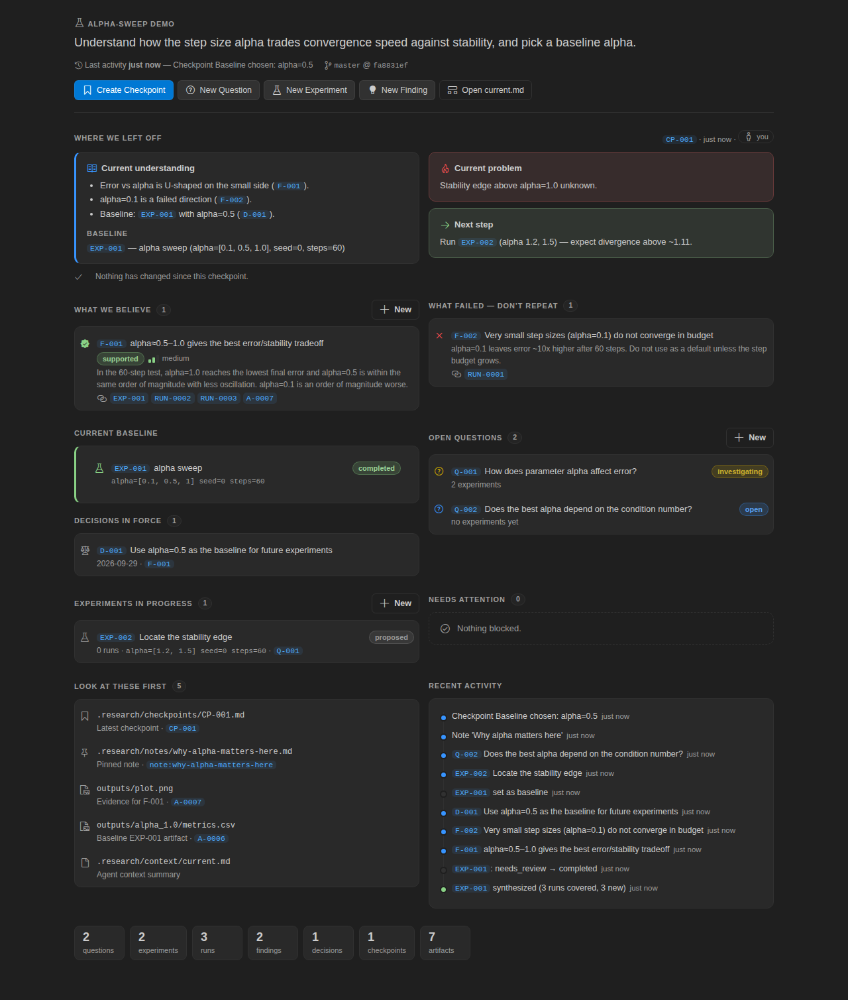

# Research Panel

**Research memory for computational projects.** A VS Code extension, a `research` CLI and a Python API that all
work on one folder, `.research/`, inside your repo. It keeps the reasoning that links your work together:

```
question → experiment → runs → artifacts / metrics → synthesis → findings → decisions → checkpoint
                 ▲
   plan → tasks ─┘   (optional: break an objective into tracked units of work)
```

Come back after a month, or after an agent ran 40 jobs, and within two minutes you can see what was tried and why,
what worked, what failed (so nobody repeats it), what the project currently believes and on what evidence, where the
files are, and what to do next.

It is built for **working with AI agents** (Claude Code, Codex, Gemini, Copilot, …) on papers and ideas:
- agents get small, focused context instead of the whole history
- several agents share one task queue without colliding
- each task can carry checks that must pass before it counts as done
- an agent's findings stay preliminary until someone else reviews the evidence
- you can hand a task to whichever agent CLI you have credit for
- project-specific skills (a coding-style skill, medical-imaging know-how, …) are loaded where they're relevant

It is **not** an experiment tracker, a dashboard, a workflow engine or a cloud service. Runs stay in the background,
and the UI puts findings, decisions and checkpoints first. Everything is local plain text plus a rebuildable SQLite index.

<p align="center"></p>

Screens: [experiment](docs/screens/experiment.png) · [finding](docs/screens/finding.png) · [run form](docs/screens/form_run.png) ·
[sidebar overview](docs/screens/overview.png) · [in VS Code](docs/screens/vscode-sidebar.png) ·
[experiment + terminal run](docs/screens/vscode-experiment-terminal.png). *(These predate Research Home and the Plans view.)*

> **Full feature list and design:** [`docs/SPEC.md`](docs/SPEC.md). This README is the "learn to use it" guide.

---

## Contents

1. [Install](#1-install)
2. [Ten-minute tutorial](#2-ten-minute-tutorial)
3. [The mental model](#3-the-mental-model)
4. [Everyday workflows](#4-everyday-workflows)
5. [The VS Code extension](#5-the-vs-code-extension)
6. [CLI cheat sheet](#6-cli-cheat-sheet)
7. [Python API cheat sheet](#7-python-api-cheat-sheet)
8. [Working with AI agents](#8-working-with-ai-agents)
9. [SLURM and Remote SSH](#9-slurm-and-remote-ssh)
10. [HPC: remote execution and portable bundles](#10-hpc-remote-execution-and-portable-bundles)
    · [Configuration (layers, machine file)](#10a-configuration)
11. [Full context export and safe upgrades](#11-full-context-export-and-safe-upgrades)
12. [Files on disk, git and backups](#12-files-on-disk-git-and-backups)
13. [Troubleshooting](#13-troubleshooting)
14. [Known issues](#14-known-issues)
15. [Development](#15-development)
16. [Documentation map](#16-documentation-map)

---

## 1. Install

You need **Python ≥ 3.8** on the machine that holds the files. Nothing else: the core uses only the standard library.

```bash
# VS Code extension (the Python core is bundled inside; no pip install needed for the panel)
code --install-extension dist/research-panel-0.7.0.vsix
#   or: Extensions view → ⋯ → Install from VSIX…

# Optional: the `research` CLI outside VS Code (HPC login nodes, sbatch scripts, notebooks)
pip install dist/research_panel-0.7.0-py3-none-any.whl     # or, from a clone: pip install -e .
```

- **Every project gets its own CLI at `.research/bin/research`.** Agents run it directly, without installing
  anything and without needing a particular `PATH`. That includes agents whose shells don't inherit VS Code's terminal
  environment, such as the Claude Code extension's Bash tool. It is a copy of the CLI that needs only Python 3. The
  extension keeps it up to date, and so do `research init` and `research bin install`. It is gitignored, because it
  records this machine's Python; each machine (laptop, remote server) gets its own copy.
- **Inside VS Code terminals, plain `research` is also on `PATH`.** The extension adds a small shim there.
- **Remote SSH:** install the VSIX once. If VS Code asks, choose "Install in SSH: &lt;host&gt;". The extension runs on the
  remote host, next to your files.
- **Upgrade:** `code --install-extension research-panel-X.Y.Z.vsix --force` and `pip install -U research_panel-X.Y.Z-*.whl`.
  The `.research/` format is versioned and migrates automatically. An older tool refuses to open a newer project rather than damage it.
- **Uninstall:** `code --uninstall-extension research-local.research-panel` and `pip uninstall research-panel`. Your
  `.research/` folders are left untouched.

No `dist/` yet? Build it with `npm install && npm run package` (see [Development](#15-development)).

---

## 2. Ten-minute tutorial

This walk-through uses the CLI so every step is visible. Each step has a VS Code equivalent (shown as **▸ UI**).
To get a finished example project instead, run `npm run demo`, which builds `examples/alpha-sweep/demo-project`.

### Step 1. Initialize the project

```bash
cd my-project
research init --goal "Find a step size alpha that converges fast without oscillating"
```

This creates `.research/`, plus a managed block in `AGENTS.md` that tells coding agents how to behave. Nothing else in the repo is touched.
**▸ UI:** Command Palette → *Research: Initialize Project*.

### Step 2. Ask a question

```bash
research question create "How does alpha trade convergence speed against stability?"
# ✓ Q-001  How does alpha trade convergence speed against stability?
```

**▸ UI:** Questions view → **+**.

### Step 3. Register an experiment *before* you run anything

An experiment is a designed test: a hypothesis, the parameters, and the conditions for stopping.

```bash
research experiment create "alpha sweep" -q Q-001 \
  --hypothesis "Error is U-shaped in alpha; best near 0.5" \
  --param 'alpha=[0.1,0.5,1.0]' --metric final_error --planned-runs 3 \
  --stop "3 runs, then synthesize"
# ✓ EXP-001  alpha sweep  [proposed]       (Q-001 moves to 'investigating')
```

The current git branch, commit and dirty state are recorded automatically.
**▸ UI:** Experiments view → **+** (*Register experiment* form).

### Step 4. Run it, with provenance

```bash
research run exec EXP-001 --param alpha=0.1 -- python sim.py --alpha 0.1
research run exec EXP-001 --param alpha=0.5 -- python sim.py --alpha 0.5
research run exec EXP-001 --param alpha=1.0 --detach -- python sim.py --alpha 1.0   # background
```

Each run gets its own `RUN-0001` directory with the command, logs, exit code, timing, host and git state (plus a
`git.diff` if the tree was dirty). Inside your script you can log without knowing any IDs:

```python
import research
research.log_metric("final_error", err)                       # attaches to the current run
research.register_artifact("out/curve.png", description="error vs step")
```

**▸ UI:** Experiment page → **Run…**, then choose *Terminal* (live output), *Background* or *SLURM*.

### Step 5. Look at what happened

```bash
research experiment show EXP-001     # design, runs table (params × metrics), artifacts
research run logs RUN-0002 --tail 20
```

**▸ UI:** Click `EXP-001`. The page shows a runs table, a bar chart per metric and an artifact gallery.

### Step 6. Synthesize, then record what you learned

After the planned runs, write down what they mean. This is the step the tool exists to enforce.

```bash
research experiment synthesize EXP-001 \
  --happened "3 runs; error minimal at alpha=0.5" \
  --interpretation "0.1 is too slow, 1.0 oscillates" \
  --next "Probe the stability edge between 1.0 and 1.5"

research finding create "alpha≈0.5 gives the best speed/stability trade-off" \
  --supports EXP-001 RUN-0002 --confidence medium --limitations "single seed"

research finding create "alpha ≥ 1.0 oscillates" --kind failure --supports RUN-0003

research decision create "Use alpha=0.5 as the default" --findings F-001
research experiment baseline EXP-001
```

A **finding** with `--kind failure` is a *failed direction*. It shows up under "What failed — don't repeat".
**▸ UI:** Experiment page → **Synthesize**, then **Finding**. Finding page → **Decision from this**.

### Step 7. Checkpoint, and come back later

```bash
research checkpoint --problem "Oscillation onset not characterised" --next "EXP-002: alpha in [1.0,1.5]"
research resume          # the "where was I?" view
```

A checkpoint is pre-filled from the current state (findings, failures, baseline, open questions, blockers). You only
add what the tool can't infer.
**▸ UI:** `Cmd/Ctrl+Alt+R` or click the status-bar item → **Research Home**.

### Step 8. Hand work to agents

```bash
research mcp install                          # once: agents get the `research` tools (Claude Code, VS Code, …)
research dispatch planner --objective "Probe the stability edge between alpha 1.0 and 1.5"
#   → opens your agent CLI on a brief; the planner creates PLAN-001 with tasks and checks, then stops
research task dispatch T-001                  # an implementer works on the first task; its checks gate "done"
research dispatch verifier F-003              # a different agent/role reviews a finding against its evidence
```

**▸ UI:** **Plan with agent…** on Research Home, **Dispatch to agent…** on a task, **Ask agent to review** on a finding.

That is the whole loop. The rest of this guide covers the details.

---

## 3. The mental model

| Object | ID | What it is | Make one with |
|---|---|---|---|
| **Question** | `Q-001` | What you're trying to understand. Can have sub-questions. | `research q create` |
| **Experiment** | `EXP-001` | A designed test: hypothesis, method, parameters, success criteria, stop conditions. A **variant** copies one and records the parameter delta. | `research exp create` / `variant` |
| **Run** | `RUN-0001` | One execution. **Always belongs to an experiment.** Captures command, params, logs, exit code, host, SLURM job and git state. | `research run exec/submit/attach` |
| **Artifact** | `A-0001` | A *reference* to a file or directory (plot, CSV, checkpoint…). Never copied. | `research artifact add`, or `research.register_artifact()` |
| **Metric** | — | A name/value (number or text) on a run or experiment, with optional step and unit. | `research metric add`, or `research.log_metric()` |
| **Synthesis** | `EXP-001/S1` | Your interpretation of an experiment's runs: what happened, worked, failed, and what's next. | `research exp synthesize` |
| **Finding** | `F-001` | **The most important object.** A reusable conclusion, with evidence links, confidence and limitations. Its kind is `result`, or `failure` (don't repeat). | `research finding create` |
| **Decision** | `D-001` | A deliberate choice based on findings, such as a new baseline. | `research decision create` |
| **Checkpoint** | `CP-001` | A snapshot of understanding: goal, beliefs, baseline, problems, next step, git commit. | `research checkpoint` |
| **Plan** | `PLAN-001` | *(optional)* A research objective with success criteria, broken into tasks. | `research plan create` |
| **Task** | `T-001` | *(optional)* A unit of work in a plan: goal, inputs, expected outputs, acceptance criteria, dependencies. | `research task create` |
| **Review** | `F-001/R1`, `T-003/V1` | A verification record: an independent review of a finding (supported / contradicted / needs work), or a run of a task's checks (pass / fail). | `research finding review`, `research task verify` |
| **Skill** | `ponytail` | Instructions for agents (an Agent Skills folder with `SKILL.md`), project-specific, imported or written by you. | `research skills add` |
| **Note** | `note:slug` | *Your* free-form Markdown in `.research/notes/`. Can be pinned and linked. Agents are told not to write here. | `research note new` |

**Rules worth knowing:**

- **Runs live under experiments.** A run cannot exist on its own, so no computation goes unaccounted for.
- **Syntheses don't become findings automatically.** You promote only what is reusable.
- **An agent's findings stay preliminary until reviewed** by you or by a *different* agent or role. Agents can't mark
  their own findings supported.
- **Nothing is deleted or rewritten.** Findings and decisions are *superseded*, and every change is logged in `.research/events.jsonl`.
- **IDs are forgiving.** `exp-1`, `EXP1` and `EXP-001` are the same, and a bare number works where the type is obvious (`research exp show 3`).
- **Every object records who made it:** `human`, `agent` (with the agent's name, role and model, e.g. `claude/verifier`)
  or `system`. The UI marks agent-written syntheses and findings in purple.

**Statuses at a glance:**

| Object | Statuses |
|---|---|
| Question | open → investigating → answered · blocked · abandoned |
| Experiment | proposed · ready → running → needs_review → completed · failed · abandoned |
| Run | queued → running → completed · failed · cancelled · unknown |
| Finding | preliminary ⇄ supported · contradicted · superseded |
| Decision | active · reversed · superseded |
| Plan | active · completed · blocked · abandoned |
| Task | todo → running → verify → done · blocked (a task is **ready** when it is `todo` and all its dependencies are `done`) |

Many transitions happen on their own. Registering an experiment under an `open` question makes the question
`investigating`. The first run moves an experiment to `running`, and when all its runs finish it becomes `needs_review`.

---

## 4. Everyday workflows

### Starting a session

| Where | How |
|---|---|
| VS Code | `Cmd/Ctrl+Alt+R` → **Research Home**: current focus, active plan, latest insights, what needs attention, key outputs, recent activity. |
| Terminal | `research resume` (full view) or `research status` (compact). |
| Agent | reads `.research/context/current.md`, a short summary regenerated after every change. |

### Running computation

| You want to… | Command |
|---|---|
| Run locally and watch output | `research run exec EXP-001 --param lr=3e-4 -- python train.py --lr 3e-4` |
| Run locally in the background (survives closing the terminal or VS Code) | add `--detach` |
| Submit to SLURM | `research run submit EXP-001 --time 04:00:00 --gpus 1 -- python train.py` |
| Record a run you already did by hand | `research run attach EXP-001 --exit-code 0 --stdout out.log -- python train.py` |
| Check, follow or cancel | `research run status RUN-0004` · `research run logs RUN-0004 -f` · `research run cancel RUN-0004` |
| Try a changed configuration | `research experiment variant EXP-001 --param alpha=1.2` (a new experiment that records `alpha: 0.5 → 1.2`) |

- Everything after `--` is your command, passed through untouched.
- `--param k=v` values are parsed: `3e-4` is a number, `true` a boolean, `[0.1,0.5]` a list, anything else text.

### Closing the loop

1. `research experiment synthesize EXP-…` covers all finished runs and marks failed runs as reviewed.
   Add `--complete` or `--fail` to close the experiment at the same time.
2. `research finding create "…" --supports EXP-… RUN-… A-…` for each reusable conclusion. Add `--kind failure` for dead ends.
3. `research decision create "…" --findings F-…` when you commit to something.
4. `research finding supersede F-001 --by F-007 --reason "…"` when you change your mind (history is kept).
5. `research checkpoint` at a stopping point.

### Using plans and tasks (optional)

Plans are for objectives that need several steps, such as "Reproduce Figure 3 of paper X". Experiments stay the
scientific unit. A task can point at the experiment it produced.

```bash
research plan create "Reproduce Fig. 3" -o "Match the paper's curve within 5%" --success "RMSE < 0.05" -q Q-001
research task create PLAN-001 "Implement baseline" --type implementation --acceptance "unit tests pass"
research task create PLAN-001 "Sanity run" --type experiment --depends T-001
research task create PLAN-001 "Full reproduction" --type experiment --depends T-002 -e EXP-003

research task next                 # first task whose dependencies are all done → T-001
research task context T-001        # focused brief: plan objective, deps' results, related experiment, skills, rules
research task start T-001          # claims it: nobody else can start it now
research task note T-001 "data loader done, model next"
research task done T-001 -r "model in model.py; 12 tests pass"
research task block T-002 "missing calibration data"
research plan show PLAN-001        # progress, ✓ ready markers, dependency arrows
```

**Checks make "done" mean done.** Give a task checks; `task done` runs them first, and a failing check blocks an agent
from completing it:

```bash
research task create PLAN-001 "Full reproduction" -e EXP-003 \
  --check "cmd:pytest -q tests/test_model.py" \
  --check "file:outputs/fig3.png" \
  --check "metric:EXP-003:rmse<=0.05" \
  --skill nv-segment-ct              # skills the agent should load for this task
research task verify T-003           # run the checks any time; records pass/fail
```

- The plan with the newest creation date among the `active` ones drives the **Current Focus** and **Active Plan** cards on Research Home.
- That plan's tasks in `verify` or `blocked` appear under **Needs Your Attention** there.
- `context/current.md` lists each active plan's next ready, running, blocked and awaiting-verification tasks.
- `research task context T-002` prints a focused brief for one task: plan objective, dependency results, the related
  question and experiment, checks, skills to load, progress notes and the rules. This is what an agent reads before
  starting a task.

### Several agents on one project

| Situation | What happens |
|---|---|
| Two agents want the same task | The first `task start` claims it; the second gets exit code 3 ("already claimed by claude/implementer"). `task next` only offers unclaimed tasks. |
| An agent stops mid-task (credits ran out, context full) | It (or you) runs `research task release T-… --note "where things stand"`. The next agent sees the note in `task context`. |
| An agent went quiet | A running task with no activity for 4 hours shows as **stale** on Research Home and in `current.md`. |
| You switch provider | Dispatch the same task to another profile: `research task dispatch T-004 --profile codex`. Research state doesn't care who works on it. |

### Comparing runs, sweeps and reports

```bash
research run compare RUN-0003 RUN-0007     # what differed (params, code, environment) and what changed (metrics, outputs)
research run sweep EXP-004 --grid lr=1e-3,3e-4 --grid bs=32,64 -- python train.py --lr {lr} --bs {bs}
research run sweep EXP-004 --dry-run -- …  # see the runs first; sweeps are checked against the run budget up front
research report                            # .research/reports/project.md + .html: findings with their plots, experiments, decisions
research report Q-002                      # just one question (or PLAN-…, EXP-…)
```

### Finding things

```bash
research search "calibration drift"        # every record: findings, experiments, tasks, runs, syntheses, notes, skills
research show F-012
```

### Editing by hand

Every question, experiment, finding, decision, checkpoint, plan and task is a Markdown file with YAML front-matter in
`.research/<kind>/`. Open it (**Open Markdown File** in the UI), change the title, status, a list or any `## Section`,
and save. The change is imported on the next sync (any CLI call, a panel refresh, or the file watcher) and logged as
`edited`.

- You can also drop a new file such as `findings/my-idea.md` into the folder. It is imported with a fresh ID.
- Everything below the `<!-- research:generated … -->` marker is regenerated, so don't edit there.
- A malformed file is skipped and logged. It never corrupts anything.

### Notes

```bash
research note new "Thoughts on the calibration failure" --link EXP-002 F-003 --pin
```

Skills (instructions for agents) are covered in [Working with AI agents](#8-working-with-ai-agents).

---

## 5. The VS Code extension

Open the **Research** icon (flask) in the activity bar.

### Sidebar views

| View | What you see |
|---|---|
| **Overview** | Goal, **Resume Project** button, stats, warnings (needs synthesis, active runs), latest checkpoint, active questions, current experiments, latest findings and decisions. |
| **Plans** | Plans with progress (`3/7 · 1 running · 1 blocked`) and their tasks underneath (who claimed them, how many checks). Inline actions: **Add Task** on a plan, **Dispatch** and **Start** on a todo task, **Complete** on a running or verify task. Right-click for Verify, Add Progress Note, Release, Show Agent Brief. Title bar: **Plan Objective with Agent…** |
| **Questions** | The question hierarchy, with experiments nested under each question. |
| **Experiments** | In progress / Completed / Failed. Runs are collapsed under each experiment and artifacts sit under runs. ⚠ marks experiments that need synthesis, and the view badge counts them. |
| **Findings** | Established · Preliminary · Failed directions · Contradicted & superseded. |
| **Decisions · Checkpoints · Notes · Artifacts** | Lists. Missing artifact files are flagged red. |
| **Agent Context** | **Agent setup** (opens the page below), `AGENTS.md`, `config.yaml`, skills (★ = always on), `context/current.md`, prompts and templates. Title bar: **Open Agent Setup**, **Import Skills…** and **Register MCP Server…**. Right-click a skill: Toggle Always-On, Update from Source, Remove. |

### Pages

- **Research Home** (`Cmd/Ctrl+Alt+R`, status-bar click, or **Resume Project**) is the landing page:
  - Current Focus: the question or objective, your current understanding, the next step and any blocker
  - Active Plan, with a progress bar and its tasks
  - Latest Insights: supported, preliminary and failed findings
  - Needs Your Attention: blocked tasks, tasks awaiting verification, failing checks, reviewers who disagree, agent
    findings awaiting review, stale tasks, experiments over budget, unreviewed failed runs
  - Key Outputs: thumbnails of evidence and baseline plots
  - Recent Activity, plus quick actions: checkpoint, new question/experiment, add task, **Dispatch** the next task,
    **Plan with agent…**, **Search**, **Report**
- **Experiment:** design, parameters (with the delta from its parent), runs table (parameters × metrics, best value
  highlighted), a bar chart per metric, artifact gallery, syntheses, findings produced, timeline.
  Actions: **Run…** · **Attach run** · **Synthesize** · **Finding** · **Variant** · Status · Edit.
- **Finding:** statement, evidence (images inline), contradicting evidence, limitations, decisions based on it,
  **reviews**, history. Actions: **Review…** · **Ask agent to review** · Edit · Decision from this.
- **Run:** copyable command, parameters, metrics, SLURM info, artifacts, tails of stdout and stderr. **Compare with…**
  opens the comparison page: metric deltas, changed parameters, code diff between the commits, outputs side by side.
- **Agent setup** (*Research: Open Agent Setup*): the active model strategy with its work → level → model table and escalation limits
  (**Change strategy…**), open tasks with their routed model, pins, checks and contract (**Pin a model…**), the project harness and its
  **hooks** (stage, approval, last result; **Review and approve…**, **Run now**, enable/disable), experiment validation (**Check**),
  model usage by strategy, skills, MCP registration per client, and the managed agent files. Changes use quick-picks and confirmations;
  strategy definitions and hook commands are edited in `config.yaml` or with `research hook add`.
- **Artifact:** previews for images, CSV/TSV, JSON, Markdown, text and logs, NPY headers and directory listings. Other formats show metadata with Open, Reveal and Copy path.
- **Plan:** progress bar, objective and success criteria, task list with dependencies. Actions: **Add Task** ·
  **Dispatch** the next ready task · **Refine with planner…** · **Report**.
- **Task:** ready / blocked / stale / checks-failing banners, who claimed it, goal, dependencies, inputs and outputs,
  acceptance criteria, **checks** with the last result, **skills to load**, **progress notes**, verification history,
  result. Actions: **Dispatch to agent…** · **Start** · **Verify** · **Note** · **Complete** · **Block** · Release · Edit.
- Every ID in any text is a link. Alt-click opens it beside the current editor.

### Forms

Create and edit forms have searchable ID pickers, key/value parameter editors (a variant highlights what changed),
segmented status controls and `Cmd/Ctrl+Enter` to save. **Run…** has three modes:

| Mode | What happens |
|---|---|
| **Terminal** (default) | Opens a terminal and runs `research run exec …` there, so you see live output. |
| **Background** | A detached process that survives closing VS Code. |
| **SLURM** | `sbatch`, with partition, time, GPUs, memory, CPUs, account and extra `#SBATCH` lines. |

If the experiment has reached its run budget, the form suggests synthesizing first. **Run anyway** is allowed and logged.

### Also

- Explorer or editor tab → right-click → **Register as Research Artifact** (multi-select works).
- **Search Research…** (Overview title bar, Home) searches every record as you type.
- **Export Research Report…** writes Markdown + HTML and opens the preview.
- The status bar shows the project, active runs (spinning) and ⚠ experiments needing synthesis.
- The panel refreshes itself when anything in `.research/` changes, for example when an agent works in a terminal.

### Settings

| Setting | Default | Controls |
|---|---|---|
| `research.pythonPath` | auto (`python3`) | Python ≥ 3.8 used to run the bundled core. Under SSH, set it in *Remote* settings. |
| `research.terminalCommand` | `true` | Put the `research` shim on `PATH` in integrated terminals. |
| `research.projectCli` | `true` | Keep the project-local CLI at `.research/bin/research` up to date (for agents that don't use VS Code terminals). |
| `research.defaultRunMode` | `terminal` | Default mode for **Run…**: `terminal` · `background` · `slurm`. |
| `research.pollIntervalSeconds` | `10` | Run-status refresh interval while runs are active. |
| `research.projectRoot` | auto | Project root, if auto-detection picks the wrong workspace folder. |

---

## 6. CLI cheat sheet

```text
research init [PATH] [--name] [--goal]           research status | resume | current | context [--print] | log [--limit N]
research show <ID>                               research mark <ID> <status> [--reason]
research project set --goal "…"                  research sync | rebuild | agents-md

research question   create|list|update|show                                  (alias: q)
research experiment create|list|show|update|variant|synthesize|baseline|run
                    |start|ready|review|complete|fail|abandon                 (aliases: exp, e)
research run        exec|submit|attach|list|status|update|cancel|logs|sync    (alias: r)
research metric     add NAME VALUE (--run RUN-… | -e EXP-…) [--step] [--unit] (alias: m)
research artifact   add PATH… [--run|-e] [-d "…"] | list                       (alias: a)
research finding    create|list|update|supersede|show                         (alias: f)
research decision   create|list|update                                        (alias: d)
research checkpoint [create] | list | show [ID] | draft                       (alias: cp)
research plan       create|list|show|update                                   (aliases: plans, p)
research task       create|list|show|context|update|start|done|block|next
                    |note|release|verify|dispatch                             (aliases: tasks, t)
research finding    review ID --verdict supported|contradicted|needs_work --notes "…"
research run        compare A B | sweep EXP [--grid k=v1,v2] [--dry-run] -- CMD {k}
research note       new|list|pin|link
research skills     list|show|add|update|remove|set|link|new|duplicate        (alias: skill)
research guide      init|status|refresh [--run]|done [SYN-ID…]                 (Scientist Guide)
research setup agents [--provider claude] [--preset scientific] [--apply] [--approve ponytail] [--probe] [--strategy NAME]
research evidence   bind|verify|value|suggest|provenance|artifact|pin|status
research source     add|mark|list                                              (literature; offline)
research orchestrate route|dispatch|freeze|attempt|correct-test|delegate|status|contract|verify|pin T-… [--tier LEVEL|opus|sonnet|haiku] [--headless]
research strategy   list|show [NAME]|use NAME [--dry-run]|validate|route T-…   (named model-allocation strategies)
research hook       list|add|enable|disable|approve|revoke|run|results         (project harness hooks; approval is human-only)
research usage      [--by strategy|model|task|level] | import FILE            (provider-reported usage; missing is never zero)
research experiment check EXP-… [--request-synthesis]                         (deterministic validation, kept apart from interpretation)
research tuning     declare|trial|select|test EXP-…                           (validation-only; test is one-shot)

research search "…"        research report [Q-…|PLAN-…|EXP-…]       research checkpoint --commit
research dispatch ROLE [TARGET] [--objective "…"] [--profile P] [--print]     research agents
research mcp [install --client claude|vscode|cursor|gemini|codex]

research config show [--effective|--sources] | check | migrate [--apply]   layered configuration
research report --full [SCOPE] [--check] [--stdout] [-o FILE]   deterministic, exhaustive context export
research upgrade --dry-run | --apply | --status                 safe project migration (preview by default)
research agents-md --preview | --diff | --apply                 the Research OS-managed AGENTS.md block
research hpc doctor | init | config [--example] | clusters      remote execution (opt-in; needs hpc.clusters)
research hpc bundle EXP-… [--format tar.gz|zip] -- CMD          portable execution package
research hpc submit EXP-… --cluster NAME [--dry-run|--yes] -- CMD
research hpc status RUN-… | sync | collect RUN-… | cancel RUN-…
research hpc import results-RUN-….tar.gz [--dry-run]
research hpc datasets list|inspect|check|fetch|adopt [ID] [--deep] [--yes]
research hpc inspect [--project SLUG]                           what is actually on the cluster
```

- **Every command accepts `--json`.** Add `--root DIR` to target a project explicitly, and `--agent NAME` / `--model M` to act as an agent.
- **Exit codes:** `0` ok · `1` error · `2` not initialized · **`3` blocked by policy** (run budget, failing checks, review gate, task claimed by someone else) · `4` not found.
- `research <command> --help` lists every option. The full table is in [SPEC §10](docs/SPEC.md#10-cli-reference).

---

## 7. Python API cheat sheet

```python
import research                                  # finds the project from the cwd or $RESEARCH_ROOT

research.get_resume_context()                    # same data as `research resume --json`
q = research.create_question("Does alpha affect error?")
e = research.create_experiment("alpha sweep", question=q["id"], hypothesis="…", parameters={"alpha": [0.1, 0.5]})
r = research.exec_run(e["id"], "python sim.py --alpha 0.1", parameters={"alpha": 0.1})
research.log_metric("final_error", 0.12, run=r["id"])
research.register_artifact("out/plot.png", experiment=e["id"], description="error vs alpha")
research.synthesize(e["id"], what_happened="…", interpretation="…")
research.create_finding("alpha=0.5 is best", supports=[e["id"]], confidence="medium")
research.create_decision("Use alpha=0.5", supporting_findings=["F-001"])
research.create_checkpoint(current_problem="…", next_experiment="…")

plan = research.create_plan("Reproduce Fig. 3", objective="…")
t1 = research.create_task(plan["id"], "Implement baseline")
t2 = research.create_task(plan["id"], "Sanity run", depends_on=[t1["id"]])
research.get_next_ready_task(plan["id"])         # → t1
research.start_task(t1["id"]); research.complete_task(t1["id"], result="done")

research.search("calibration")                   # retrieval
research.compare_runs("RUN-0003", "RUN-0007")
research.review_finding("F-004", "needs_work", "only one seed")
research.write_report("Q-001", fmt="both")
research.dispatch("verifier", "F-004")           # → {argv, env, brief}; doesn't start anything
```

**Inside a run** started by `research run exec` or `submit`, call `research.log_metric(...)` and
`research.register_artifact(...)` **without IDs**. They write only into the run directory, which is safe on compute
nodes, and are picked up on the next sync.

---

## 8. Working with AI agents

Agents use the same records you do, through the `research` CLI or MCP tools, and leave the same trail a careful human would.

### Context: small and focused, in layers

| Layer | What the agent reads | Size |
|---|---|---|
| Bootstrap | `AGENTS.md`: the managed block `research init` writes (your text outside the markers is never touched) | ~½ page |
| Project state | `research current` (= `.research/context/current.md`): goal, checkpoint, beliefs, failures, experiments, active plans and their next tasks, attention items, always-on skills, rules. Regenerated after every change and **capped** (default ~3k tokens; long lists end with "… N more") | ≤ 12k chars |
| One task | `research task context T-…`: goal, acceptance criteria, checks, plan objective, what the dependencies produced, related experiment state, skills to load, progress notes | ~1 page |
| On demand | `research search "…"`, `research show <ID>`, run logs | as needed |

### Several agents, one subscription or many

**Profiles** are the agent CLIs you have; **roles** decide who does what. They're set in `.research/config.yaml`:

```yaml
agents:
  default_profile: claude
  roles: {planner: claude, implementer: codex, verifier: claude, analyst: null}   # null → default_profile
  profiles:
    claude: {command: claude, model: null}       # e.g. model: claude-opus-5-5
    codex:  {command: codex,  model: null}
    gemini: {command: gemini, prompt_flag: -i}
```

**Dispatch** writes a focused brief and starts the agent on it in your terminal:

```bash
research dispatch planner --objective "Reproduce Table 2"   # creates a plan + tasks with checks, then stops
research task dispatch T-004                                # implementer (or the task's role)
research task dispatch T-004 --profile gemini               # ran out of Claude credit? hand it to another CLI
research dispatch verifier F-007                            # reviews a finding against its evidence
research dispatch analyst EXP-003                           # synthesizes an experiment, proposes findings
research dispatch verifier F-007 --print                    # just print the command
research agents                                             # profiles, roles, which CLIs are installed
```

- Everything a dispatched session records is attributed to `profile/role` (e.g. `codex/implementer`).
- Nothing runs unattended: you start each session and can watch it.
- In VS Code, **Dispatch to Agent…** picks the role and profile, then opens a terminal.

### Scientist Guide (optional)

A living, readable scientific narrative (`docs/SCIENTIST_GUIDE.md`) for an incoming scientist. It complements, and does
not replace, `README.md`, the technical docs and `research report`. Every synthesis makes the guide *pending*; it is only
*current* after an agent edits it and runs `research guide done`.

```bash
research guide init                  # bare-bones guide from goal + questions (never overwrites)
research guide status                # pending syntheses + their findings' statuses
research guide refresh               # prints the command for the guide agent (the active strategy's `guide` level, else guide.model)
research guide refresh --run         # ...or starts it now; the agent follows the `scientist-guide` skill
research guide done [SYN-ID …]       # agent records what it has reflected (default: all pending)
```

Existing projects: run `research init` once to copy the new `scientist-guide` and `scientific-handoff` skills and
refresh the AGENTS.md block. Convert a researcher's discussion into a Question/Plan/Experiment/Tasks with the
`scientific-handoff` skill.

### Orchestration: strategies, tiers, contracts and hooks (optional)

**Intended workflow** (written with the legacy Opus/Sonnet/Haiku tiers; under a strategy read them as its deep / coordinator / fast levels). The researcher agrees the science (possibly elsewhere) and hands it over with the
`scientific-handoff` skill → Opus turns it into a Question, Plan, Experiment and bounded tasks → Sonnet writes the
contract and independent tests, freezes them, and decides whether Haiku can implement → Haiku implements against the frozen
tests (max 3 attempts) → Sonnet reviews and runs integration checks → `task done` (checks gate it) → Opus runs and
synthesizes registered experiments, then refreshes the Scientist Guide. Skip any tier a task doesn't need. Ordinary unit tests
are task checks; scientific computations are registered experiments and runs with their usual budgets.

**What is and isn't automatic.** `setup agents` is opt-in and writes only Research OS-managed files. External code (Ponytail)
needs `--approve ponytail`. No MCP servers, plugins, Claude Code hooks or permission changes are ever installed (project harness hooks
are different: they are yours, and run only after you approve them). The VS Code **Agent setup** page (*Research: Open Agent Setup*)
shows and drives strategy, hooks, per-task pins, usage, skills and MCP registration; everything else stays CLI-driven. Plain
`research dispatch` is unchanged and does not route by tier unless an allocation strategy is active (then it uses the same resolver).


**Legacy tier routing** (what you get until you choose a strategy), by difficulty and verifiability, layered on the existing plans, tasks, checks and `dispatch`:
Opus designs/synthesizes and maintains the Scientist Guide, Sonnet writes contracts + independent tests and reviews,
Haiku implements fully specified, frozen-test units. Native Claude Code subagents cannot spawn subagents, so Opus→Sonnet and
Opus→Haiku run in-session via `.claude/agents/research-*.md`, while Sonnet→Haiku runs as a separate `claude` process via
`research orchestrate dispatch … --run`. Usage is recorded only for `--headless` runs and manual records (see below).

```bash
research setup agents --provider claude --preset scientific            # dry run: plan only
research setup agents --provider claude --preset scientific --apply    # agents, skills, config (add --approve ponytail)
research orchestrate route T-001                                        # which tier and model, and why
research orchestrate delegate T-001 "parse_metrics()" --tier haiku --acceptance "…" --check "cmd:pytest -q tests/x.py"
research orchestrate freeze T-002 tests/test_metrics.py                 # Sonnet freezes the oracle first
research orchestrate dispatch T-002 --run                               # Haiku (refused without frozen tests)
research orchestrate attempt T-002 --tier haiku --outcome fail --category incorrect_implementation
research orchestrate correct-test T-002 tests/test_metrics.py --reason "…" --tier sonnet
research tuning declare|trial|select|test EXP-001 …                     # validation-only tuning, one-shot held-out test
```
Limits live in `.research/config.yaml → orchestration.limits` (Haiku 3 attempts, Sonnet 2, 2 escalations, 50 tuning evaluations).

#### Allocation strategies (which model does which part)

Three independent layers, so each can change without the others:

| Layer | Owns | Where |
|---|---|---|
| **Profile** | an executable + model (`claude-fast`, `codex`, …) | `agents.profiles` |
| **Strategy** | which *level* (`fast` / `balanced` / `deep` — the strategy's own names) handles which kind of task, retry limits, escalation | `orchestration.strategies.<name>`, selected by `orchestration.active_strategy` |
| **Harness** | how *this project* prepares and verifies work: skills, context files, an instructions file, verification commands, hooks | `harness:` (references are carried into briefs and never interpreted; only approved hooks execute, see below) |

A strategy never names a vendor model; it maps levels to profiles (`levels: {fast: claude-fast, …}`), so a new model
replaces one profile, not the routing. A project with no `active_strategy` keeps the legacy Opus/Sonnet/Haiku tier routing
above, unchanged.

| Strategy | Coordinator / tests | Checkable work | Unchecked work | Scientific synthesis | Retries → escalation |
|---|---|---|---|---|---|
| `sonnet_first` (recommended for new projects) | balanced | fast | balanced | **deep** | fast×3 → balanced ×2 → human |
| `opus_first` | balanced; **deep plans** | fast | balanced | deep | fast×3 → balanced ×2 → deep → human |
| `haiku_max` | balanced | fast | balanced | balanced (deep only with `--level deep`) | fast×4 → balanced ×2 → human |
| `sonnet_heavy` | balanced | **balanced** (fast only for `task_type: mechanical`) | balanced | deep | fast×2 → balanced ×2 → human |

Defaults: `fast`=`claude-haiku-5-5`, `balanced`=`claude-sonnet-5-5`, `deep`=`claude-opus-5-5` (profiles `claude-fast|balanced|deep`).
"Checkable" means the task has both checks and acceptance criteria; routing is deterministic from task metadata, with no LLM
classifier.

```bash
research strategy list                          # built-in / global / project, and which is active
research strategy show sonnet_first             # resolved levels → profiles → models, routes, limits, fingerprint
research strategy use sonnet_first              # this project only (--dry-run validates and reports, changes nothing)
research strategy use opus_first                # switch; applies to future dispatches only
research strategy validate                      # unknown profiles, escalation cycles, missing routes, harness refs
research strategy route T-001 [--strategy haiku_max] [--level deep]   # which model, and why — launches nothing
research orchestrate dispatch T-001 --strategy haiku_max               # one dispatch only; config untouched
research setup agents --apply --strategy sonnet_first                  # opt a project in while setting up agents
```

**Define your own** (project file `.research/config.yaml`, or the machine file for all your projects):

```yaml
orchestration:
  active_strategy: pravah
  strategies:
    pravah:
      extends: haiku_max            # inherit everything, change only what differs
      attempts: {fast: 2}           # dicts merge key by key; lists and scalars replace — nothing is concatenated
      route: {unchecked: fast}
harness:                            # independent of the strategy above
  name: numerical_research
  skills: [pde-conventions]         # .research/skills/pde-conventions (project-local, not installed globally)
  context: [docs/conventions.md]
  instructions: docs/AGENT_NOTES.md
  checks: ["pytest tests/oracle -q"]
```

*Precedence* (highest first): explicit `--profile`/`--agent-model` > `--level` > `--strategy` for one dispatch > project file
> machine file > built-in. A strategy name defined in several layers is merged key by key, the highest layer winning per key.
Two projects never share state: each reads its own file, and a project edit never writes the machine file or the built-ins.

*Delegation and dispatch use one resolver.* `research dispatch`, `orchestrate dispatch|delegate|route` and `guide refresh` all
call the same `strategy.select`, so a balanced-level coordinator running `orchestrate delegate T-1 "…" --acceptance … --check …`
reaches the fast worker without repeating a model id, and an unchecked child stays at balanced. The Scientist Guide uses the
strategy's `guide` level (an explicit `--profile`/`--model` still wins). If a level's profile is missing or its model is not in
`orchestration.available`, dispatch fails with a hint; it never substitutes another model.

*Verification and escalation.* Frozen tests are required whenever the implementer is not the coordinator level (the test
author), and `task done` still refuses while frozen tests differ; neither depends on a model name. A level that implemented a
task cannot `correct-test` it. A verifier dispatch moves to a level whose profile+model differs from the task's implementers;
if none does, the brief and record say `independent: false` and a human must confirm. After a failure the strategy returns
retry / escalate / block / integration_review; an escalation to `human` becomes `block`; `max_escalations` bounds the loop;
cycles are rejected by `validate`. Scientific-assumption failures follow `on_scientific_assumption`. Run budgets, tuning
budgets and numerical-evidence gates are untouched.

*Provenance and active sessions.* Every strategy dispatch writes `.research/cache/dispatch/<name>.policy.json` (strategy,
fingerprint of the resolved policy and profiles, level, profile, provider, model, reason, overrides, independence, harness
fingerprint, git revision, status), appends a copy to the task ledger (`dispatches`), and puts `RESEARCH_STRATEGY`,
`RESEARCH_STRATEGY_FINGERPRINT`, `RESEARCH_AGENT_LEVEL` in the session env. Switching strategy logs a `strategy_changed` event
and changes nothing else: no task, run, finding, review or frozen test is rewritten, and a running session keeps what it
started with. `orchestrate attempt --usage '{"input_tokens": 1200}'` records only usage you actually have; `orchestrate status`
sums only what was reported and otherwise says `unavailable` (never 0).

*Not implemented / manual:* hot-swapping a running session, per-strategy regeneration happens only when you re-run `research setup agents --apply`,
and the items listed under **Not implemented** below. Strategy dispatch passes the model explicitly and never writes or overwrites
user-owned agent files or skills.

#### Hooks, task contracts, usage, overrides, agent files, experiment checks (0.7.0)

**Harness hooks** run project commands at fixed stages, so programs, not model tokens, verify what a program can verify.
```yaml
harness:
  hooks:
    conservation: {stage: post_implementation, command: "pytest tests/oracle -q", timeout: 120, required: true}
    data-present: {stage: preflight, command: "test -f data/mesh.h5"}
```
Stages: `preflight` (before `orchestrate dispatch`), `post_implementation` (in `orchestrate verify`), `pre_experiment` (before any
run is created: a failure blocks it, exit 3, and registers nothing), `post_experiment` (in `experiment check`). The orchestrator may
propose a hook with `research hook add NAME --stage … --command …`; **nothing runs until a human runs `research hook approve`**
(agents get exit 3). Approval is a hash of stage + command + timeout, so editing a command revokes it. Hooks have timeouts (process
group killed), truncated output, an `--advisory` mode, and every run is appended to `.research/hooks/results.jsonl`. An unapproved or
disabled hook is reported as skipped, never as passed. `research hook list|enable|disable|run|results|revoke`.

**Task contracts** live in the task's orchestration ledger: `research orchestrate contract T-001 --objective … --context …
--expected-output … --allowed-file 'src/*.py' --constraint … --require …` (or the same flags on `delegate`). The worker's brief carries
the contract. `research orchestrate verify T-001 --tier fast [--record]` checks frozen-test integrity, the file boundary (files changed
since dispatch outside `allowed_files`), approved `post_implementation` hooks and the task's checks, prints the diagnostics for the
worker, and with `--record` logs an attempt and returns the bounded next step (retry within the strategy's limit, then escalate). If no
deterministic verifier ran at all the result is *not a pass*. Frozen tests and independent verification are unchanged.

**Usage accounting.** `research orchestrate dispatch T-001 --headless` (or `research dispatch … --headless`) runs the session with the
profile's `headless_args` and records what the provider reports (`usage_parser: claude_json` for the `claude-*` profiles: input, output,
cache read/write tokens, cost) in `.research/usage.jsonl` with strategy, fingerprint, level, profile, model and task.
`research usage [--by strategy|model|task|level|profile] [--task T]` compares them; `research usage import FILE` ingests a saved
`claude -p --output-format json` result; `orchestrate attempt --usage '{…}'` is the manual fallback and is also ledgered. Absent values
stay absent: totals sum only records that reported the field and show `reported/records`; cost is provider-reported, never calculated.
Interactive sessions expose no usage, so none is recorded for them. Headless Claude runs cannot answer permission prompts: add the
flags you trust (e.g. `--permission-mode acceptEdits`) to the profile's `headless_args`.

**Per-task model overrides.** `research orchestrate pin T-001 --level deep` (or `--profile P`, `--agent-model M`), `… pin T-001 --clear`;
`research orchestrate route T-001` shows the effect. A pin applies to that task's *implementer* dispatches under the active strategy
(verifier dispatch keeps its independence rule), beats the strategy, loses to per-dispatch `--level/--profile/--agent-model`, and is
recorded in the dispatch snapshot (`overrides.task_override`) and the task notes.

**Strategy-aware agent files.** With an active strategy, `research setup agents --apply` writes `.claude/agents/research-<level>.md`
for each level (coordinator / worker / scientist derived from the strategy, the level table, escalation limits, delegation, and
pointers to `research task context` and `research hook list` instead of copied project data). Managed legacy `research-haiku|sonnet|opus.md`
files are moved to `.research/cache/removed-agents/`; files without the managed marker and your own agents are never touched. A strategy
change makes the generated files `update` (re-run setup to refresh).

**Experiment-aware orchestration.** `research experiment check EXP-001 [--request-synthesis]` verifies with programs: runs reached a
terminal state and completed, metrics were logged, registered artifacts still match their hashes, approved `post_experiment` hooks pass
(pending HPC runs point at `research hpc sync`). It lists separately what needs *your interpretation* (unreviewed failed runs, due
synthesis, unapproved hooks), writes a `validated` event, and with `--request-synthesis` only *prepares* the analyst session. Existing run
and synthesis budgets are unchanged.

**Not implemented:** automatic invocation of `experiment check` when a run finishes, hook stages for HPC bundle import, price-table cost
calculation, live-verified `claude -p` JSON parsing (the parser follows the documented result shape and ignores anything missing), and
usage for interactive sessions.

### Numerical evidence and provenance

A finding can be linked to an experiment ID and still state a wrong number. **Bindings** make the number checkable by
software instead of trusted. Prefer letting Research OS *read* the value:

```bash
research evidence value RUN-0002 --metric final_error          # the recorded value, unit, status
research evidence bind F-004 --run RUN-0002 --metric final_error --partition design         # claim read from the record
research evidence bind F-004 --derive ratio --input RUN-0002:final_error --input RUN-0003:final_error --claim 1140
research evidence bind F-003 --run RUN-0002 --metric final_error --claim 0.0021             # a typed (wrong) number…
research evidence verify F-003                                  # → MISMATCH: claimed 0.0021 but the recorded evidence gives 0.00123786
research finding review F-003 --verdict supported --notes "…"   # → refused, even for a human, until the numbers verify
research evidence bind F-003 … --supersedes F-003/B1            # correct by superseding; history stays
```

- Statuses: `verified · mismatch · missing · stale (an artifact changed) · unverifiable` (failed run, NaN, ambiguous step,
  incompatible units). A plausible explanation never turns a mismatch into a pass.
- Verified numbers are **not** a reviewed interpretation: `supported` still needs an independent reviewer and written notes.
- Qualitative and legacy findings are untouched. `research evidence suggest F-…` lists unbound numbers in an old statement.
- Artifacts: `research evidence artifact A-…` checks the registered hash (streamed); large files that were never hashed can be
  pinned (`evidence pin`). Changes to cited artifacts show up as integrity warnings; registered metadata is never rewritten.
- `research evidence provenance RUN-…` shows commit/dirty state, seeds, split identities and lockfile hashes, and lists what
  was **not** recorded. `research source add|mark` keeps literature identity, examination and support separate (offline).
- `research report` adds an evidence table under each finding that has bindings.
- Worked example: [examples/alpha-sweep](examples/alpha-sweep) (`SCIENTIST_GUIDE.example.md`, `REPORT.example.md`).

### Verification gates

- **Checks gate tasks.** If a task has checks (`cmd:…`, `file:…`, `metric:…`), `research task done` runs them first. A
  failure blocks an agent (exit code 3, with the failing checks) and shows on Research Home.
- **Reviews gate findings.** An agent can't mark a finding `supported`, whether by creating it that way, editing it or
  using `mark`. It stays preliminary until `research finding review F-… --verdict supported --notes "…"` comes from
  **someone else**:
  - you, or
  - a different agent, or
  - the same CLI in a different role (`claude/implementer` ≠ `claude/verifier`)

  A supported verdict needs linked evidence. *Needs work* and *contradicted* verdicts show up as "reviewer disagrees".
- **You are never blocked**, with one exception: a finding whose bound numbers fail verification can't be marked supported by anyone (see *Numerical evidence* below). Otherwise humans get warnings, unless `agent_policy.enforce_for_humans: true`.

### MCP: the same tools, natively

```bash
research mcp install                        # writes .mcp.json (Claude Code) + .vscode/mcp.json (VS Code / Copilot);
                                            # uses .research/bin/research when `research` isn't on PATH
research mcp install --client cursor --client gemini --client codex   # codex: prints `codex mcp add research -- research mcp`
```

- Agents get 33 typed tools, including `research_current`, `task_next`, `task_context`, `task_start`, `task_done`,
  `run_start`, `finding_create`, `finding_review`, `runs_compare`, `skill_show`, `dispatch_prepare` (follows the active strategy),
  `report_full`, `upgrade_preview` and `hpc_doctor` / `hpc_sync` / `hpc_bundle`. Strategies, hooks, contracts, usage and experiment check
  are CLI-only for now.
- Policy blocks come back as tool errors with the hint, so the agent knows what to do.
- The server is `research mcp` (stdio). It needs `research` on the agent's PATH. VS Code terminals already have it;
  elsewhere, `pip install` the wheel.

### Project skills

Skills are folders with a `SKILL.md`, the format Claude Code, Codex and most agents share. Import the ones a project
needs. They're copied into `.research/skills/` and linked into `.claude/skills/` and `.agents/skills/`, so agents
discover them natively:

```bash
research skills add DietrichGebert/ponytail --list                     # a GitHub repo: 6 skills (ponytail + companions)
research skills add DietrichGebert/ponytail --only ponytail --always    # the core prompt, listed for every session
research skills add DietrichGebert/ponytail --only ponytail-review      # a companion, loaded on demand
research skills add ~/Downloads/medical-AI-skills --list   # a folder you downloaded: see what's inside
research skills add ~/Downloads/medical-AI-skills --only dicom-series-preflight nv-segment-ct
research skills set nv-segment-ct --applies-to experiment analysis   # suggested in briefs for these task types
research task create PLAN-001 "Segment the CT volumes" --skill nv-segment-ct     # or assign it to a task / plan
research skills update ponytail          # re-import from where it came from
research skills remove nv-segment-ct     # kept in .research/cache/removed-skills/
```

- In repos that bundle many agent integrations, the importer takes the canonical `skills/<name>/` copy and ignores
  hidden agent-specific folders. That's why ponytail imports cleanly.
- `.research/skills.yaml` records where each skill came from (source, commit) and its settings. Your `SKILL.md` files
  are never modified.
- Four general skills ship with every project: `run-experiment`, `synthesize-experiment`, `reproduce-paper`,
  `clean-dataset`.
- An agent can also find and import a skill itself, for example: "download the medical imaging skills and load them".
  It uses `research skills add`.
- **▸ UI:** Agent Context view → **Import Skills…** (folder or git URL, pick which, on demand or always on).

### Run budget and authorship

- **Run budget.** After `max_runs_without_synthesis` finished runs (default 5) or `max_failed_runs_without_review`
  failed runs (default 3), `research run …` **exits with code 3** for agents until someone synthesizes. Agents also
  can't register a new experiment while another needs synthesis. `--override "reason"` is logged.
- **Authorship is automatic.** Claude Code is detected (`CLAUDECODE=1`); dispatch and MCP name the agent; otherwise
  set `RESEARCH_AGENT=…` or pass `--agent …`. Actions in the VS Code UI are always recorded as human.
- **Opening prompt** for a fresh session: `.research/prompts/resume-session.md`.

---

## 9. SLURM and Remote SSH

**SLURM defaults** go in `.research/config.yaml`. Per-run flags override them.

```yaml
backends:
  slurm:
    partition: gpu-common
    account: mylab
    time: "04:00:00"
    gpus: 1                 # → --gres=gpu:1   ("a100:2" → --gres=a100:2)
    mem: 32G
    cpus: 8
    extra_args: ["--constraint=a100"]
    setup:                  # shell lines run before your command in every job
      - module load cuda/12.1
      - source ~/miniconda3/etc/profile.d/conda.sh && conda activate myenv
```

- `research run submit EXP-003 -- python train.py` writes `runs/RUN-XXXX/job.sbatch` and submits it.
- Status comes from the run directory, then `squeue`, then `sacct`, so TIMEOUT and OOM kills are caught too.
- Compute nodes never touch SQLite. Jobs only write to their own run directory, which keeps NFS and Lustre safe.

**Remote SSH:** the extension runs on the remote host (`extensionKind: workspace`), so git, SQLite, SLURM and file reads all
happen there. Your laptop only draws the UI. Detached and SLURM runs keep going when your laptop sleeps, and status
catches up when you reconnect.

---

## 10. HPC: remote execution and portable bundles

Opt-in. With no `hpc.clusters` in `.research/config.yaml` nothing changes and every `research hpc` command
says so. Authentication is OpenSSH's: `ssh_host` is an alias you can already `ssh` to, and Research OS
stores no passwords, keys or tokens.

```yaml
# .research/config.yaml  —  `research hpc config --example` prints this
hpc:
  default_cluster: duke
  clusters:
    duke:
      transport: ssh
      ssh_host: plp-drcc-login2         # must already work: `ssh plp-drcc-login2`
      paths:
        workspace_root: /APPROVED/HPC/WORKSPACE     # you must supply real, approved paths
        shared_data: /APPROVED/HPC/DATA
      slurm: { time: "04:00:00", cpus: 4, mem: 16G, gpus: 1, setup: ["module load python/3.11"] }
      limits: { max_cpus: 64, max_gpus: 8, max_time_hours: 72, max_mem_gb: 512 }
      project: { slug: pravah }
```

### Recipe: bundle an experiment for manual execution

Use this when there is no direct connection, or when a human will run the job.

```bash
research hpc bundle EXP-001 -- python train.py --alpha 0.5
# → .research/hpc/bundles/EXP-001-RUN-0007.tar.gz   (RUN-0007 is already recorded locally)

# copy it over, then on the cluster — no agent, no network, no Research OS install needed:
tar -xzf EXP-001-RUN-0007.tar.gz && cd EXP-001-RUN-0007
bash scripts/preflight.sh      # checks python, sbatch, datasets; changes nothing
bash scripts/submit.sh         # sbatch, or a foreground run where Slurm is absent
bash scripts/collect.sh        # → results-RUN-0007.tar.gz

# back on the laptop:
research hpc import results-RUN-0007.tar.gz
```

The import reconciles **the same run record** the bundle was built from — metrics, artifacts, logs, exit
status and provenance all land on `RUN-0007`. No duplicate run is created, and re-importing the same
archive changes nothing.

### Recipe: submit the same experiment over SSH

```bash
research hpc doctor                                   # SSH, sbatch/squeue/sacct, python, storage, paths
research hpc init                                     # create the project's remote directories (creates only)
research hpc submit EXP-001 --cluster duke --dry-run   # shows exactly what it would do; submits nothing
research hpc submit EXP-001 --cluster duke --yes       # bundles, uploads, verifies, sbatch, records the job id
```

**The dry run states what the job would reserve, and `--yes` is refused without it:**

```text
  Resources this would RESERVE:
    4 CPUs · 1 GPU · 16G memory · up to 04:00:00 wall-time
    worst case if it runs to the wall-time limit: 16.0 CPU-hours and 4.0 GPU-hours
```

Slurm bills the *reservation*, not the usage, so this is the number that matters. `research run submit
--dry-run` and `research run sweep --mode slurm --dry-run` print the same block (a sweep also totals it
across every grid point). Agents are instructed to show you these numbers and wait for an explicit yes,
and never to raise cpus/gpus/mem/time on their own initiative.

### When `doctor` says something is wrong

Every failing check prints its own fix, and the last line says what still works
(`ready: ssh-slurm, bundle` → everything; `bundle` only → portable bundles, which need no connection).
Agents have a procedure for this: `research skill show hpc-setup`.

The one that trips everyone up:

```text
✗ slurm    sbatch=NO, squeue=NO, sacct=NO
```

…while `ssh <host>` followed by `sbatch` works fine by hand. `ssh host <cmd>` gets a **non-interactive**
shell, which on many clusters skips the profile scripts (and auto-loaded modules) that put Slurm on
`PATH`. Research OS runs remote commands through `bash -lc` so they see the same environment you do, and
when Slurm is still missing it searches `module avail` and names the module in its fix hint. Compare the
two yourself:

```bash
ssh <host> 'command -v sbatch; echo $PATH'               # non-interactive: often a bare PATH
ssh <host> 'bash -lc "command -v sbatch; module list"'   # login shell: what you get interactively
```

Set `login_shell: false` for a cluster whose profile is slow or unwanted non-interactively, and put the
needed `module load` lines in `slurm.setup` instead. `slurm.setup` runs **inside every job**, which is
where your code's own modules (python, cuda, compilers) belong — a compute node does not inherit the
login node's environment.

Other checks: `ssh connectivity` failing usually means `BatchMode` cannot answer a password or MFA prompt
(use a key or an agent); a path that "does not exist yet" is created by `research hpc init` if its parent
is writable; a read-only `shared_data` is fine; without `scancel` only `research hpc cancel` is affected.

### Recipe: reconnect after a multi-day job

Slurm keeps running while your laptop is closed. Research OS catches up on demand:

```bash
research hpc sync          # adopts uncertain submissions, updates status, imports available results,
                           # and lists the experiments that now need interpretation
research hpc status RUN-0007
research hpc collect RUN-0007 --max-bytes 1000000     # fetch results; bigger outputs stay remote
```

`sync` is safe to run at any time and is idempotent. It never submits anything and never starts an agent —
scientific interpretation stays your decision (`research experiment synthesize EXP-001`).

**If a submission is reported uncertain**, the job may well be queued. Run `research hpc sync`: it reads the
receipt the job script wrote and adopts the existing job. Never re-run `submit` for that run.

### Datasets: the filesystem is the source of truth

There is **no registry**. A dataset is a directory under `paths.shared_data`, described by a `manifest.json`
inside it. Two projects reuse the same bytes by looking, not by remembering.

```bash
research hpc datasets list                 # scan the shared data directory
research hpc datasets check ERA5 [--deep]  # manifest → inventory → checksum, strength reported explicitly
research hpc datasets fetch ERA5           # reuses a valid copy; staging needs --yes
research hpc datasets adopt ERA5 --dataset-version 2025 --description "verified by hand"
```

A directory with no manifest is **neither trusted nor re-downloaded**: inspect it, then `adopt` it. An
interrupted download can never read as complete, and Research OS never deletes remote data.

---

## 10A. Configuration

`.research/config.yaml` holds **only what your project changes**; everything else is inherited. The
commented block beneath your settings lists the commonly adjusted defaults — uncomment a line to override
it (editing it *while commented* does nothing, and `research config check` will say so).

```
built-in defaults  ←  ~/.config/research-os/config.yaml  ←  .research/config.yaml  ←  command flags
                       (optional, shared by every project on this machine)
```

Allocation strategies (`orchestration.strategies`), agent `profiles` and `harness` defaults can live in the machine file too: a project then
sets only `orchestration.active_strategy` or the one key it overrides. Hook approvals (`harness.hooks_approved`) are per project and never
inherited, so a machine-level hook still needs approval in each project.

```bash
research config show                  # just this project's overrides
research config show --effective      # every value actually in force
research config show --sources        # which layer supplies each value
research config check                 # types, HPC profiles, duplicate keys, unrecognized keys
research config migrate               # diff a legacy file into sparse form; --apply to write it
```

**Your comments survive.** Research OS rewrites only the keys it is asked to change, so a file you have
annotated stays annotated — `research project set --goal …` touches one line. (The one exception is
`config migrate`, which re-serializes the whole file; it warns first and keeps a `.before-migrate` copy.)

**Unrecognized keys are kept**, never dropped — they may belong to a newer Research OS or to you.

### The machine layer: define a cluster once

Put cluster facts in `~/.config/research-os/config.yaml` and each project needs only its own remote name:

```yaml
# ~/.config/research-os/config.yaml — shared by every project on this machine
hpc:
  default_cluster: duke
  clusters:
    duke:
      ssh_host: plp-drcc-login2            # an alias from ~/.ssh/config; never a password or key
      paths:
        workspace_root: /home/you/research-os
        shared_data: /scratch/lab/shared-data
      slurm: {time: "04:00:00", cpus: 4, mem: 16G, gpus: 1}
      # Remote commands run through `bash -lc` by default, because a plain `ssh host sbatch` often
      # misses the profile scripts (or auto-loaded modules) that put Slurm on PATH. Set this to false
      # if your site's profile is slow or does something unwanted non-interactively.
      # login_shell: true
      # remote_shell: bash
```

```yaml
# <project>/.research/config.yaml — all this project adds
hpc:
  clusters:
    duke:
      project: {slug: pravah}
```

`$RESEARCH_CONFIG=/path/to/file` overrides the location. With no machine file, behaviour is exactly as
before.

---

## 11. Full context export and safe upgrades

### Recipe: export and validate all research context

```bash
research report --full --check            # → .research/reports/project-full.md
research report --full EXP-001 --stdout   # one experiment, to stdout
research report --full --check --json     # machine-readable coverage result; nonzero exit on failure
```

This is an exhaustive, **deterministic** dump of everything recorded — every run, every metric entry (not
just final values), every synthesis, superseded findings and decisions, notes, reviews, the event history,
and an explicit list of what is missing or was never recorded. For a fixed project state the bytes are
identical on every run, and generating it writes nothing but the output file (no event, no reconciliation).

It involves **no model and no interpretation**: it retrieves, joins, orders and renders records. Don't quote
it as if it concluded something — `--check` verifies coverage, not correctness.

`--check` re-derives the coverage manifest from markers in the rendered Markdown, so a dropped or duplicated
record fails verification. It separates **exporter failure** (a record omitted or duplicated — a bug) from
**source-data incompleteness** (a missing artifact file, an unsynthesized experiment — reported, not blamed
on the exporter). Add `--stamp` if you want a generation timestamp, which makes the output non-reproducible
by design.

### Recipe: upgrade an existing project without losing research history

```bash
research upgrade --status      # installed version vs project schema
research upgrade --dry-run     # exactly what would change; touches nothing, not even the database
research upgrade --apply
```

The upgrade adds missing directories, restores missing default skills, deep-merges missing config defaults,
refreshes `.research/bin/`, runs any schema migration, and offers the managed `AGENTS.md` block. It
**preserves** every record, your own config values, unknown config keys, customized skills and hand-edited
Markdown. It is safe to re-run, and an older tool refuses to open a newer project rather than damaging it.

### Recipe: preview and update the managed AGENTS.md block

```bash
research agents-md --preview   # the block this version generates
research agents-md --diff      # unified diff of the current vs. the new block
research agents-md --apply     # rewrites only the managed region
```

Everything outside the two marker comments is yours and is preserved byte for byte, including line endings.
If the markers are missing, Research OS proposes adding a block without disturbing your content. If they are
duplicated or malformed it **refuses** and tells you how to fix it rather than guessing — a deliberately
human-reviewed workflow.

---

## 12. Files on disk, git and backups

```
AGENTS.md                      ← only the block between research markers is managed
.research/
├── config.yaml                ← goal, agent_policy, SLURM defaults           (edit freely)
├── questions/ experiments/ findings/ decisions/ checkpoints/ plans/ tasks/   (Markdown, edit freely)
├── runs/RUN-0001/             ← run.json, status.json, stdout.log, stderr.log, metrics.jsonl, git.diff, job.sbatch
├── artifacts.jsonl  syntheses.jsonl  metrics.jsonl  reviews.jsonl  events.jsonl   ← append-only records
├── skills.yaml                ← where imported skills came from + their settings
├── notes/  skills/  prompts/  templates/  context/current.md  reports/
├── research.db                ← SQLite index: git-ignored, rebuilt automatically
└── cache/                     ← index backups, dispatch briefs, removed skills
.claude/skills/  .agents/skills/   ← links to .research/skills/<name> (so agents discover skills natively)
.mcp.json  .vscode/mcp.json        ← only if you ran `research mcp install`
```

- **Commit `.research/`.** Its own `.gitignore` already excludes `research.db`, `cache/` and run logs. A fresh clone
  rebuilds the index on first use.
- **Large artifacts are referenced, not copied.** Back them up wherever they live.
- **ID collisions after merging branches:** if two branches both created `EXP-012`, `research rebuild` logs a conflict.
  Rename one file (and its `id:`) to fix it.
- **`research rebuild`** recreates the index from the text files at any time and keeps a backup in `.research/cache/`.
- **Commit snapshots:** `research checkpoint --commit` (or the checkbox in the checkpoint form) commits `.research/`
  **only**. It leaves your other changes alone and never pushes. Set `git.commit_checkpoints: true` to do it on every checkpoint.

---

## 13. Troubleshooting

| Symptom | Fix |
|---|---|
| "Could not start Python" | Set `research.pythonPath` (in *Remote* settings under SSH) to a Python ≥ 3.8. See **Research: Show Log**. |
| `research: command not found` in a terminal | Use `.research/bin/research` (works in any shell), or open a *new* VS Code terminal and check `research.terminalCommand`. |
| Claude Code (or another agent) can't find `research` | Have it run `.research/bin/research …`; the managed block in `AGENTS.md` already tells it to. If that file is missing, open the project in VS Code with the extension, or run `research bin install`. |
| `exit code 3` | A policy blocked an agent. The message says which: run budget (synthesize first, or `--override "reason"`), failing task checks (fix, then `task done` again), review gate (ask another agent or a human to `finding review`), or a task claimed by someone else (`task next` for another, or `--force`). |
| Agent says the `research` MCP tools are missing | Run `research mcp install`, then restart the agent. When `research` isn't on `PATH`, the registration uses the absolute path of `.research/bin/research`, so no install is needed. |
| Dispatch says the CLI is "not on PATH" | Install that agent CLI, or point its profile's `command` at the right executable in `.research/config.yaml`. |
| A skill isn't picked up by Claude Code / Codex | `research skills link` re-creates `.claude/skills` and `.agents/skills`. Entries there that aren't links (your own skills) are left alone. |
| A run is stuck at `running` | `research run status RUN-…` reconciles it. A local run whose process died becomes `unknown`. |
| A hand edit doesn't show up | Any CLI call or panel refresh imports it. Malformed YAML is skipped and logged (`research log`). |
| "schema vN newer than this tool" | Upgrade the extension or CLI. A newer version wrote the project. |
| Corrupt or locked `research.db` | Delete it, or run `research rebuild`. It is rebuilt from the text files. |

---

## 14. Known issues

No open bugs are known as of 2026-10-12. That covers 432 automated tests and the TypeScript typecheck. The real-VS-Code harness and a real
Claude Code session calling the MCP tools were last run before 0.5, so the Agent setup page and `--headless` usage capture have not been
exercised in a live VS Code or a live `claude -p` session. Bugs found along the way are listed in
[SPEC §22.1](docs/SPEC.md#22-known-issues-and-limitations).

Limitations worth knowing (the evidence, Scientist Guide and orchestration layers are listed in full in [SPEC §22.2](docs/SPEC.md#22-known-issues-and-limitations)):
- Numerical verification checks that a number matches a recorded metric or declared calculation; it does not prove the science is right. Free-form prose is not parsed, claims are compared after rounding, and large unhashed files can only be size-checked until pinned.
- The Scientist Guide's prose is not machine-checked, and refreshing it requires an Opus agent to be run (`guide refresh` only prepares it).
- Orchestration has a VS Code page (Agent setup) but no MCP tools; usage is recorded only for `--headless` runs and manual records; Sonnet→Haiku runs as a separate process because Claude Code subagents can't spawn subagents.
- The review gate is a guard rail for honest agents, not a security boundary. Roles are self-declared, and hand edits
  of Markdown files count as human edits.
- Nothing schedules work automatically: you dispatch agents, and plans don't complete themselves.
- The full list is in [SPEC §22.2](docs/SPEC.md#22-known-issues-and-limitations).

---

## 15. Development

```bash
pip install -e ".[dev]"             # editable `research` CLI + pytest
npm install                         # extension dev dependencies
npm run build                       # bundle the extension (esbuild)
npm test                            # 432 pytest tests + TypeScript typecheck
npm run package                     # → dist/research-panel-X.Y.Z.vsix, dist/*.whl
bash scripts/clean_install_test.sh  # release check: fresh venv, full protocol, moved copy, path-leak scan
npm run demo                        # example project in examples/alpha-sweep/demo-project
```

- **Run the extension from source:** open `packages/vscode-extension` in VS Code and press F5. The dev build uses `packages/core` directly.
- **UI end-to-end:** `python scripts/e2e_code_server.py <project> <shots-dir>` drives the real UI in code-server with Playwright.
- **Real VS Code harness:** `RESEARCH_TEST_WORKSPACE=<demo> npm run test:ext` downloads VS Code, installs the VSIX and runs
  its checks (last run before 0.5). It needs network access. From a terminal inside VS Code, prefix it with `env -i HOME=$HOME PATH=$PATH`.

| Path | Contents |
|---|---|
| `packages/core/research/` | Python core: schema, store, config layers, services, runs, plans, context, views, verification, evidence, guide, agents, strategy, orchestrate, harness, hooks, usage, MCP, RPC, runner, backends, `hpc/` (module map in SPEC §20) |
| `packages/cli/research_cli/` | `research` CLI (argparse) |
| `packages/vscode-extension/` | Extension: `src/` (TypeScript), `src/render/` (HTML), `media/` (CSS/JS) |
| `tests/python/` | pytest suites |
| `examples/alpha-sweep/` | Stdlib-only demo |

---

## 16. Documentation map

| Document | Status | Read it for |
|---|---|---|
| **README.md** (this file) | current | Learning to use the system |
| [**docs/SPEC.md**](docs/SPEC.md) | current | Every feature, the design rationale, data model, algorithms, CLI/API/RPC reference, extension behaviour |
| [CHANGELOG.md](CHANGELOG.md) | current | What changed between versions |
| [docs/UPGRADING.md](docs/UPGRADING.md) | current | A copy-pasteable upgrade sequence for an existing project (including the optional strategy/hook steps) |
| [docs/ARCHITECTURE_AUDIT.md](docs/ARCHITECTURE_AUDIT.md), [docs/TRANSFORMATION_SUMMARY.md](docs/TRANSFORMATION_SUMMARY.md) | proposal, largely implemented | The "Research OS" redesign plan. Built: plans/tasks, tiered context, MCP tools, roles and dispatch, verification gates, Research Home, git snapshots. Deliberately not built: unattended autonomous orchestration and direct model-API adapters (tiered orchestration exists, but a human or an agent session starts each step). SPEC.md describes what exists. |
| [docs/PHASE_0_SPEC.md](docs/PHASE_0_SPEC.md) | proposal, implemented | The original design for plans and tasks. Where it differs from SPEC.md, SPEC.md is authoritative. |
| [docs/MCP_INTEGRATION.md](docs/MCP_INTEGRATION.md) | proposal, implemented differently | Planned an MCP-SDK server; the built one uses the standard library only (SPEC §7.8). |

MIT licensed.
