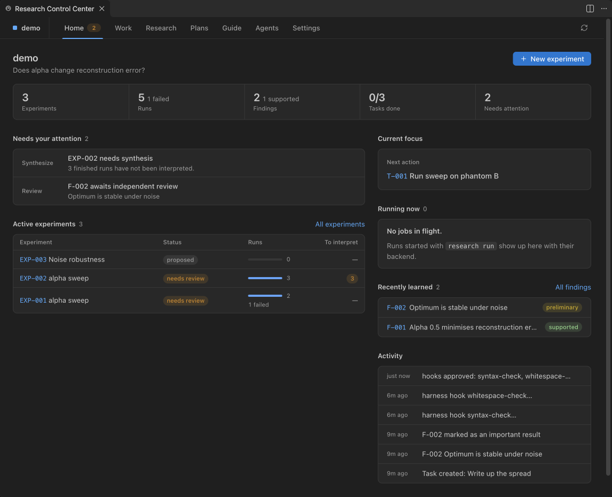
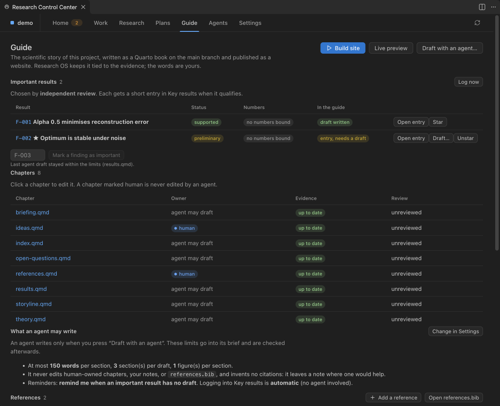
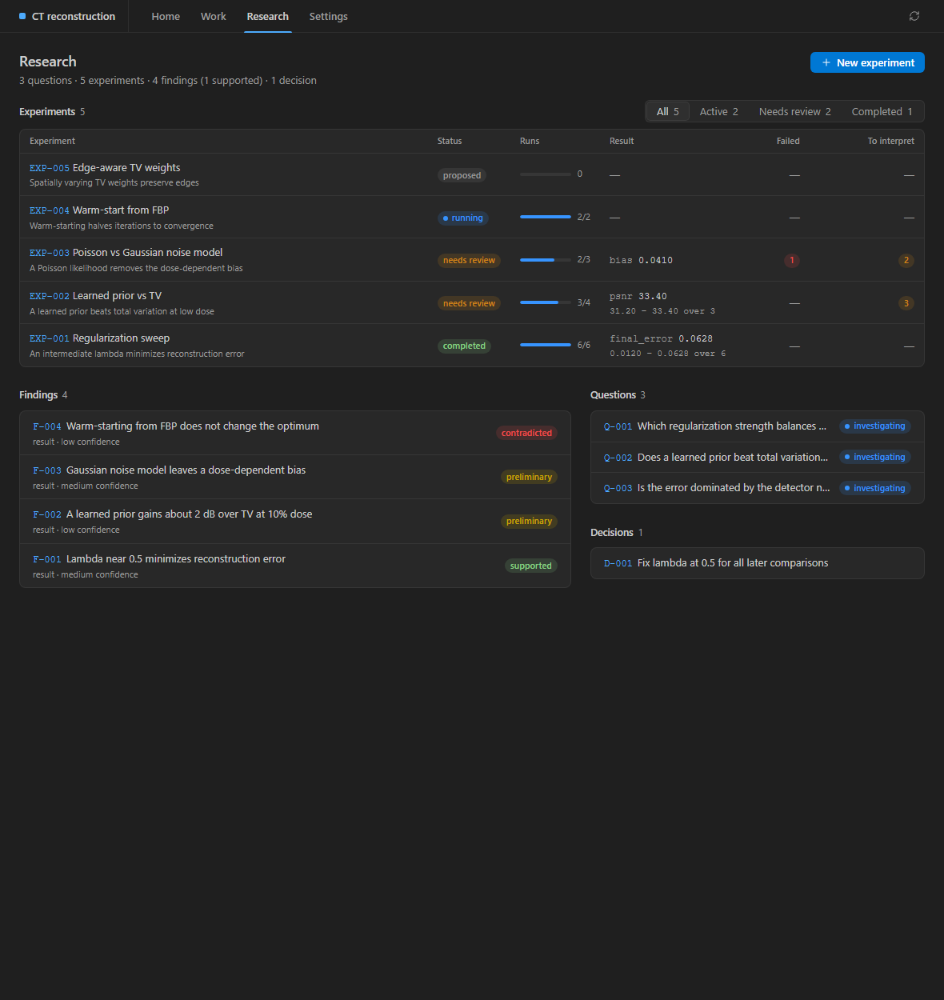
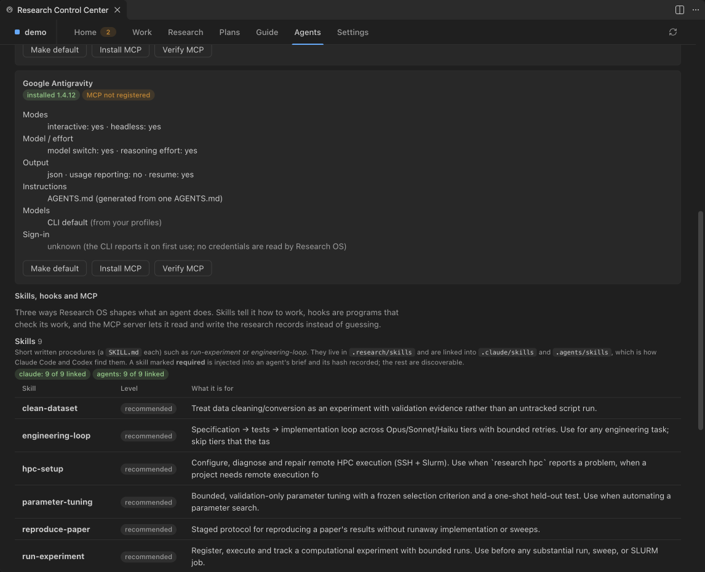
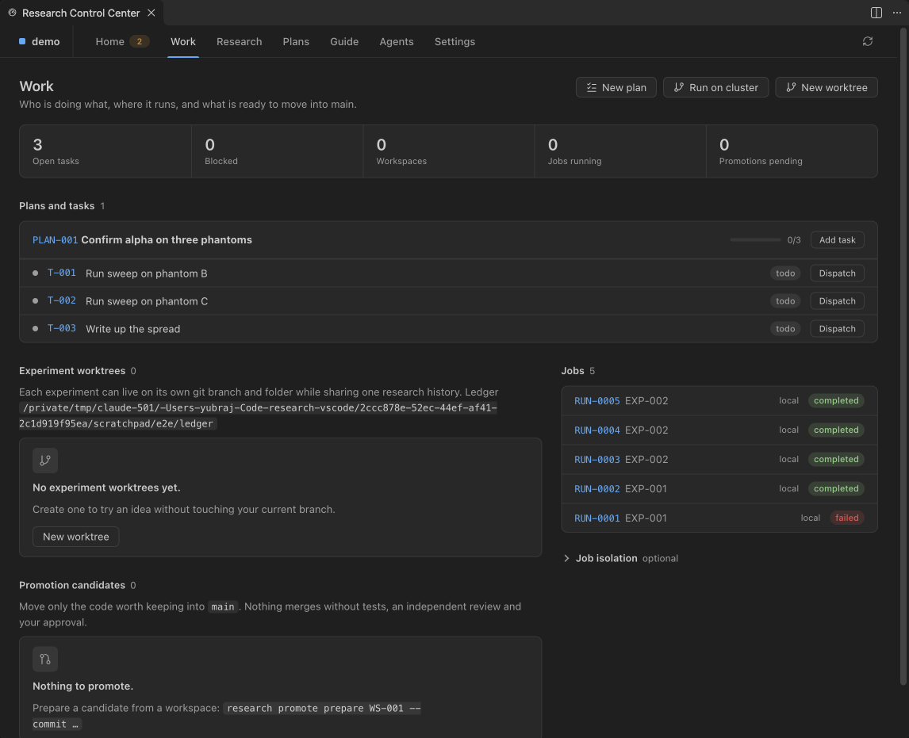
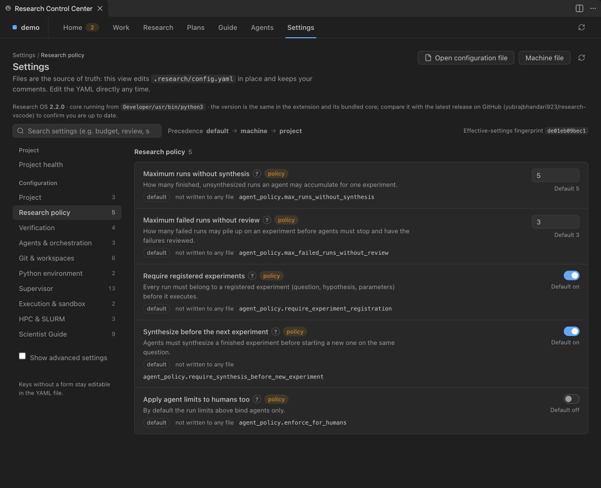

# Research OS

Project-local research memory for computational science. The `research` CLI is the product; a terminal UI, a VS Code extension,
a Python API and an MCP server are interfaces to the same `.research/` directory.
It preserves what you intended, what was implemented, what experiments showed, what you learned,
and what should happen next.

**Version 3.1.1.** Project format 2. v1 projects are not upgraded or migrated (see [Recovery](#recovery)).



Two related lifecycles keep scientific conclusions separate from completed work:

```text
Question → Experiment → Runs → Metrics / Artifacts → Synthesis → Findings → Decisions → Checkpoint
Plan → Tasks → Agent delegation → Implementation → Verification → Completion
```

Research OS is local and provider-independent. Canonical records are text files; SQLite provides
an index. It supports local runs, Remote SSH, SLURM and portable HPC bundles. It does not replace
scientific notebooks, validate scientific truth, or autonomously schedule your research. Optional job isolation
restricts what a *job* can touch; it does not sandbox *agents* (agent boundaries are advisory). There is no required cloud service.

> [Getting started](https://github.com/yubrajbhandari923/research-vscode/blob/main/docs/QUICKSTART.md) · [Guide](https://github.com/yubrajbhandari923/research-vscode/blob/main/docs/GUIDE.md) · [Skills, hooks and MCP](https://github.com/yubrajbhandari923/research-vscode/blob/main/docs/AGENT_TOOLS.md) · [Governance](https://github.com/yubrajbhandari923/research-vscode/blob/main/docs/GOVERNANCE.md) ·
> [Supervisor](https://github.com/yubrajbhandari923/research-vscode/blob/main/docs/SUPERVISOR.md) · [Chat](https://github.com/yubrajbhandari923/research-vscode/blob/main/docs/CHAT.md) · [Troubleshooting](https://github.com/yubrajbhandari923/research-vscode/blob/main/docs/TROUBLESHOOTING.md) · [Changelog](https://github.com/yubrajbhandari923/research-vscode/blob/main/CHANGELOG.md).

## Quick start (5 minutes)

```bash
# 1. Install the CLI from PyPI, in its own isolated environment ([tui] adds the terminal UI)
uv tool install "research-panel[tui]"      # or: pipx install "research-panel[tui]"   (from a wheel or from source: see Install)
research version

# 2. Create a project (a preview; add --apply to create it)
research init sparse-ct --layout ledger --name "Sparse CT" --goal "What you are trying to find out" --agents claude
research init sparse-ct --layout ledger --name "Sparse CT" --goal "What you are trying to find out" --agents claude --apply
cd sparse-ct/main && research doctor

# 3. Set up an agent and a model strategy (you install and sign in to the agent's own CLI)
research agent setup claude --apply
research strategy use balanced_first

# 4. Run a plan: validate, apply, start the supervisor
research plan yaml template -o plans/research.yaml           # edit it, or use the example in the guide
research plan yaml validate plans/research.yaml
research plan yaml apply plans/research.yaml
research plan run PLAN-001

# 5. Watch and steer
research tui                                                 # needs the [tui] extra
research plan status PLAN-001
```

Prefer VS Code? Install the `.vsix` from the same release, open an empty folder and run **Research: Initialize Project**.
The step-by-step guide, with a worked example, is [docs/QUICKSTART.md](https://github.com/yubrajbhandari923/research-vscode/blob/main/docs/QUICKSTART.md).

## Feature tour

| You want to | Look at |
|---|---|
| Install, update, match the extension and CLI versions | [Install](#install), [Getting started](https://github.com/yubrajbhandari923/research-vscode/blob/main/docs/QUICKSTART.md#1-install) |
| Let agents run a plan while you sleep, with checks and retries | [Supervisor](https://github.com/yubrajbhandari923/research-vscode/blob/main/docs/SUPERVISOR.md), [Plans, tasks and agents](#plans-tasks-and-agents) |
| Choose which model does which work (fast, balanced, deep) | [Providers and strategies](https://github.com/yubrajbhandari923/research-vscode/blob/main/docs/PROVIDERS.md), [Model allocation](#model-allocation-and-contracts) |
| Watch from a terminal or a panel | [`research tui`](https://github.com/yubrajbhandari923/research-vscode/blob/main/docs/QUICKSTART.md#5-watching-and-steering), [Control Center](#control-center) |
| Answer questions and steer from Telegram or Discord | [Chat](https://github.com/yubrajbhandari923/research-vscode/blob/main/docs/CHAT.md) |
| Keep scientific decisions in human hands | [Governance and the approval PIN](https://github.com/yubrajbhandari923/research-vscode/blob/main/docs/GOVERNANCE.md) |
| Survive provider usage limits unattended | [Usage limits](https://github.com/yubrajbhandari923/research-vscode/blob/main/docs/QUICKSTART.md#8-usage-limits) |
| Tell the story of your results | [Scientist Guide](https://github.com/yubrajbhandari923/research-vscode/blob/main/docs/GUIDE.md) |
| Give agents skills, hooks and MCP tools | [Skills, hooks and MCP](https://github.com/yubrajbhandari923/research-vscode/blob/main/docs/AGENT_TOOLS.md) |
| Fix a problem | [Troubleshooting](https://github.com/yubrajbhandari923/research-vscode/blob/main/docs/TROUBLESHOOTING.md) |

The project layout is `main/` (your code, GitHub's root), `ledger/` (research records) and `experiments/` (one worktree each). Initialization links the shipped
skills for your agents, registers the MCP server, approves nine starter hooks and creates the Scientist Guide. Nothing is pushed.

## Control Center

`Research: Open Control Center` opens one panel with seven areas:

| Area | What it is for |
|---|---|
| **Home** | Project goal, current focus, items that need you (syntheses, reviews, blocked tasks, promotions), active experiments, running jobs, recent findings and activity |
| **Work** | Plans and tasks, experiment branches (git worktrees), jobs, promotion candidates with their gates, optional job isolation |
| **Research** | **Reports** (write the project report or the complete export, open them), experiments with run progress and latest result, findings, questions, decisions |
| **Plans** | YAML plans run by the persistent supervisor: phases, attempts, approvals, proposals |
| **Guide** | The Scientist Guide: important results, chapters and their owners, what an agent may write, references, publishing, Quarto, build and preview |
| **Agents** | Providers (Claude Code, Codex, Antigravity), and **Skills, hooks and MCP**: what is loaded, one-click fixes |
| **Settings** | Every configurable setting with `?` help, its origin (default, machine or project file), file and key; **the Research OS version**; project health |

| Guide | Research and reports |
|---|---|
|  |  |

| Skills, hooks and MCP | Plans |
|---|---|
|  |  |

| Home | Work | Settings |
|---|---|---|
|  |  |  |

Light-theme versions of every screen are in [`docs/screens/control-center-v2/`](https://github.com/yubrajbhandari923/research-vscode/tree/main/docs/screens/control-center-v2/) (`*-light.png`), and the Guide page after a build is `guide-built-*.png`.
First run in an empty folder opens a short setup wizard; **New experiment** is a guided form that never runs anything.

## The Scientist Guide

`research report` records **everything**; the guide is the **short story you tell**. It is a [Quarto](https://quarto.org) book in
`docs/scientist-guide/` on the main branch that builds to a website (and a PDF), with your own theme, citations and notes:

- **Important results are logged for you.** A finding an independent review marks supported (or that you star) gets a short entry with its claim and plot in *Key results*. No agent is involved and entries are never rewritten.
- **An agent drafts only when you ask**, within limits you set (words per section, sections, figures); `research guide draft check` reports any overrun. You edit, add context, cite, and approve.
- **References from day one:** `references.bib`, `research guide cite add --bibtex …`, `[@key]` in the text; a cited key that is missing is an error.
- **Publish on every push:** `.github/workflows/publish-guide.yml` deploys the scientific edition with GitHub Pages (one-time: Settings → Pages → Source: GitHub Actions).
- **Two editions, one text:** the website is clean prose; the researcher edition adds an evidence panel per chapter. Claims and figures carry provenance; review and approval are separate steps.

Quarto is needed only to build ([install or update it](https://github.com/yubrajbhandari923/research-vscode/blob/main/docs/GUIDE.md#updating-quarto)). Full guide: [docs/GUIDE.md](https://github.com/yubrajbhandari923/research-vscode/blob/main/docs/GUIDE.md).

## Skills, hooks and MCP

Skills tell an agent *how* to work, hooks are programs *you approve* that check its work, and the MCP server lets it read and write the
records instead of guessing. Every new project is equipped out of the box:

- **Skills:** the *Core Research* pack (hypothesis design, validation oracles, failure triage, reproducibility audit, uncertainty analysis, literature evidence, scientific visualization, independent review, promotion of validated work, plus curated debugging, review and experimental-design skills), and any of eight field packs you pick in the wizard: Scientific Python, Machine Learning, Physics/Numerical, Medical Imaging, Quantum Computing, HPC, Frontend, Scientific Writing. Third-party skills (Ponytail, Superpowers, K-Dense, Anthropic, Kalaris) are curated, attributed copies with pinned commits and licenses ([THIRD_PARTY_NOTICES.md](https://github.com/yubrajbhandari923/research-vscode/blob/main/THIRD_PARTY_NOTICES.md)); Trail of Bits and Vercel skills, whose licenses do not allow bundling, are install-from-source. A skill reaches an agent's brief only when the task type or role matches.
- **Hooks:** nine cheap starter checks (syntax, whitespace, git integrity, secrets scan, task scope, frozen tests, experiment configuration, numeric invariants, artifact integrity), approved by you; project-aware extras (lint, format, pytest, tsc) are detected and offered, never automatic.
- **MCP:** registered for each enabled agent.

Agents → **Skills, hooks and MCP** has a searchable catalog with one-click install, packs, per-skill activation, enable/disable, hook approval and test results, and updates; `research skills …` and `research hook …` do the same, and `skills.packs` in the machine config sets the default for every new project. [docs/AGENT_TOOLS.md](https://github.com/yubrajbhandari923/research-vscode/blob/main/docs/AGENT_TOOLS.md).

## Install

Research OS is a command-line tool first. The core needs Python 3.8 or newer (Node is only needed to build the VS Code extension from source).
There are three ways to install the CLI and terminal UI; the VS Code extension is a separate, optional download.

### Option 1: from PyPI (recommended)

The CLI and terminal UI are on [PyPI](https://pypi.org/project/research-panel/) as `research-panel`.

```bash
uv tool install "research-panel[tui]"       # an isolated environment, `research` on your PATH ([tui] = the terminal UI)
research version
research tui                                 # the terminal UI; `research --help` lists everything
```

With pipx, or with pip in a virtual environment you manage:

```bash
pipx install "research-panel[tui]"
# or
python3 -m venv .venv && . .venv/bin/activate && pip install "research-panel[tui]"
```

If `research` is not found afterwards, run `uv tool update-shell` (or `pipx ensurepath`) and open a new terminal. Extras: `tui` is the terminal UI,
`discord` the Discord bot (Python 3.10 or newer); combine them as `research-panel[tui,discord]`. Then follow the [Quick start](#quick-start-5-minutes).

### Option 2: from the release wheel

Every [GitHub release](https://github.com/yubrajbhandari923/research-vscode/releases/latest) carries the same wheel that is on PyPI, an sdist, the
extension (`.vsix`) and `SHA256SUMS`. Use it to pin an exact file, install without PyPI, or check what you install.

```bash
# download the wheel and SHA256SUMS from the release page, then verify and install
grep '\.whl$' SHA256SUMS | shasum -a 256 -c -          # Linux: sha256sum -c -
uv tool install "research-panel[tui] @ file:///full/path/to/research_panel-X.Y.Z-py3-none-any.whl"

# or straight from the release URL (replace X.Y.Z)
uv tool install "research-panel[tui] @ https://github.com/yubrajbhandari923/research-vscode/releases/download/vX.Y.Z/research_panel-X.Y.Z-py3-none-any.whl"
```

Without extras it is just `uv tool install ./research_panel-X.Y.Z-py3-none-any.whl` (or `pipx install ./research_panel-X.Y.Z-py3-none-any.whl`, or
`pip install` the same file inside a virtual environment).

### Option 3: build the wheel yourself

```bash
git clone https://github.com/yubrajbhandari923/research-vscode.git && cd research-vscode
uv build                                       # or: python -m pip install build && python -m build   -> dist/*.whl and dist/*.tar.gz
uv tool install "research-panel[tui] @ file://$PWD/dist/research_panel-X.Y.Z-py3-none-any.whl"
```

This builds only the Python package and needs no Node. The VS Code extension and the full test suite are in [Development](#development) below.

### The VS Code extension (optional)

Download `research-panel-X.Y.Z.vsix` from the release page. The CLI from one of the options above must be installed first.

```bash
code --install-extension research-panel-X.Y.Z.vsix
```

Or in VS Code: Extensions → `…` → **Install from VSIX…**. Install the extension on the workspace host when using Remote SSH, and the CLI there too.

### Updating

```bash
uv tool upgrade research-panel          # or: pipx upgrade research-panel, or: research self-update
```

`research self-update` downloads the newest release wheel, checks it against `SHA256SUMS`, and reinstalls with the tool that installed it
(`uv tool`, pipx or pip). `--check` only reports, `--version X.Y.Z` pins, `--from-file WHEEL` installs offline, and a major (breaking) upgrade needs `--major`.
On any failure the existing install is untouched.

**The extension is a thin client.** It runs the installed `research` (the `research.cliPath` setting, then `PATH`, `~/.local/bin` and pipx's bin directory) and
bundles no Python. It needs a core with the same major version and a minor at least what it declares; on a mismatch the status bar warns and
**Research: Show Version Info** names the command to run. `research version --json` reports what is installed.

**Agents.** Each initialized project gets `.research/bin/research`, a generated machine-local launcher agents can run without `PATH`; refresh it with
`research bin install --force` after an upgrade, a new machine or moving the project.

**Supervisor after a reboot or upgrade.** Opening a project in VS Code starts the supervisor only when a plan is running or Telegram is enabled; otherwise run `research supervisor start`, and after an upgrade `research supervisor restart` (`research self-update` also restarts known supervisors).

To build from a clone:

```bash
python3 -m venv .venv
source .venv/bin/activate
python -m pip install -e '.[dev]' build
npm install
npm test
npm run package        # VSIX, wheel and sdist in dist/
```

Activate the environment before `npm test`: it invokes `python3` from PATH.

## Start a research project

```bash
cd my-project
research init --goal "Measure how step size affects convergence"
research question create "Which step size converges reliably?"
research experiment create "step-size study" -q Q-001 \
  --hypothesis "An intermediate step size converges fastest" \
  --param 'alpha=[0.1,0.5,1.0]' --metric final_error --planned-runs 3 \
  --stop "Three runs, then synthesize"
```

Initialization writes `.research/`, a managed block in `AGENTS.md`, and the project-local CLI.
It preserves text outside the managed block. Default skills and templates live inside `.research/`.

Register an experiment before executing its runs. With your own `sim.py`:

```bash
research run exec EXP-001 --param alpha=0.1 -- python sim.py --alpha 0.1
research run exec EXP-001 --param alpha=0.5 -- python sim.py --alpha 0.5
research run exec EXP-001 --param alpha=1.0 --detach -- python sim.py --alpha 1.0
research run logs RUN-0001 --tail 20
research experiment show EXP-001
```

Inside a registered run, the Python API attaches records to the current run:

```python
import research

research.log_metric("final_error", 0.002)
research.register_artifact("outputs/curve.png", description="Convergence curve")
```

Logs, parameters, command, timing, exit state and available git metadata are recorded. Artifacts
are references, not backup copies. Detached runs survive the initiating CLI; reconciliation reads
the runner's status files. A disappeared process without a recorded outcome becomes `unknown`.

For an executable example, use a **new** destination:

```bash
bash examples/alpha-sweep/run_demo.sh /tmp/my-research-demo
```

The demo refuses an existing destination. It must never erase a research directory to start over.

## Synthesize, decide and resume

After examining actual results, record the interpretation explicitly:

```bash
research experiment synthesize EXP-001 \
  --happened "Describe the completed runs and their measured results" \
  --interpretation "Explain what the evidence supports and what it does not" \
  --next "Describe the next discriminating experiment"
research finding create "A conclusion supported by the observed results" \
  --supports EXP-001 RUN-0001 --confidence medium --limitations "Single seed"
research finding create "A direction that failed" --kind failure --supports RUN-0003
research decision create "The next research decision" --findings F-001
research checkpoint create --problem "Remaining uncertainty" --next "Next experiment"
research status --full
research current
```

These are templates for your observations, not conclusions to copy without evidence. A synthesis
does not automatically create a finding. Agent findings remain preliminary until reviewed by an
independent actor or role. Failed directions remain discoverable. Superseding records preserves
historical context.

`research evidence` binds numerical claims to recorded metrics or supported calculations.
Numerical consistency is distinct from scientific validity: software cannot establish that the
experiment, metric or interpretation is appropriate. The **Scientist Guide** is the curated counterpart of `research report`: a Quarto book on the main branch
(`docs/scientist-guide/`) with your key results, citations (`references.bib`) and a theme, published as a website on every push.
Important results are logged into it automatically, an agent writes a short first draft only when you ask (within word, section
and figure limits you set), and you finish it. Claims and figures carry provenance; review and approval are separate steps
(`docs/GUIDE.md`).

In VS Code, open **Research Home** with `Ctrl/Cmd+Alt+R`. Questions, experiments, findings,
decisions, checkpoints and plans also have sidebar views. Experiment pages expose runs, logs,
metrics and artifacts. The CLI remains available for interfaces without a dedicated UI.

## Plans, tasks and agents

```bash
research plan create "Implement and validate the next experiment"
research task create PLAN-001 "Implement the simulator" --check 'cmd:python -m pytest -q'
research task next
research task context T-001
research task start T-001
research task verify T-001
research task done T-001 --result "Implementation and validation summary"
```

Tasks can carry dependencies, acceptance criteria, file or metric checks, and progress notes.
Dependency cycles introduced by task updates are rejected. Claims are serialized in SQLite;
another actor's claim requires an explicit takeover. Starting a task with unmet dependencies
still warns. Plans do not complete automatically.

Completion checks apply to `task done`, task status updates, `mark` and creating a task already `done`; all
of them run the same verification (`orchestrate.verify_work`): frozen-test integrity, a consistent task
specification, file boundaries, approved hooks and task checks. The result is *passed*, *blocked* (a check failed,
a required hook is unapproved, or the specification conflicts) or *unverified* (nothing deterministic ran). A task with
no verifier can still be completed administratively, and that is recorded as such; it is never reported as verified.
`research task verify` exits non-zero unless the result is *passed*. Passing checks never make a finding
scientifically supported; that needs the separate independent review. Failed checks block agents;
humans receive warnings and an audit event unless `agent_policy.enforce_for_humans` is enabled. Frozen-test integrity
blocks completion independently. Roles are self-declared conventions, not authenticated identities.
Hand-edited files and direct Python internals are outside the CLI policy boundary.

```bash
research agent dispatch planner --objective "Design the next experiment"
research task dispatch T-001
research agent dispatch verifier F-001
```

`research task context T-001` (also the MCP `task_context` tool, the RPC call behind the editor, and the start of every
dispatch brief) prints one *effective task specification*: objective, inputs, constraints, permitted files, expected
outputs, acceptance criteria, checks, frozen tests and hooks needing approval, each with its source. If the task record and
its orchestration contract disagree, both values are shown as a conflict and dispatch and completion are blocked until
someone reconciles them; nothing is silently overridden.

Dispatch prepares a brief and, for tasks, a single-use launch command. The active strategy chooses the model by
default; `--profile`/`--agent-model` are explicit overrides (task pin, then strategy, is the order below them). Every
task dispatch path (plain, routed, orchestrated, editor, MCP) applies the same specification, dependency,
frozen-test and preflight checks. Launching the command takes a per-task lock held for the provider's lifetime, so
two processes cannot run the same task; a second launch exits with code 3. Execution records under
`.research/orchestration/executions/` distinguish *prepared*, *launched*, *running*, *completed*, *failed* and
*unknown* (the launcher was interrupted and the provider's fate is unobserved). A launcher killed outright (SIGKILL) cannot update its record, which then stays *running*; the lock, not the record, is the authority on whether the task is still being executed. Preparing or sending a command to a
terminal is not evidence that an agent ran. Missing provider executables, credentials
or model access must be resolved in that provider's environment. No third-party skill is installed
merely by selecting a strategy.

### Model allocation and contracts

```bash
research strategy list
research strategy use balanced_first
research strategy validate
research orchestrate --help
```

Built-in strategies map task classes to configured model profiles:

| Strategy | Allocation intent |
|---|---|
| `balanced_first` | Balanced model coordinates, fast model implements checkable work, deep model only for scientific synthesis (preferred for new projects) |
| `deep_first` | Deep model plans and interprets, balanced translates to contracts and tests, fast implements |
| `fast_max` | Maximise verified fast-model execution; balanced orchestrates and is the escalation target; deep only on request |
| `balanced_heavy` | Balanced model coordinates and implements, fast only for mechanical work, deep for milestone synthesis |

The older names `sonnet_first`, `opus_first`, `haiku_max` and `sonnet_heavy` are accepted as aliases of these.

Custom strategies can extend a built-in. Profile model identifiers are configuration, not evidence
of provider availability. Per-dispatch overrides take precedence over task pins, then strategy
routing. Task pins apply to implementer dispatches; verifier routing retains its independence rule.
Without an active strategy, legacy tier configuration remains supported for existing projects.

Contracts persist objective, context, outputs, allowed files, constraints and verification guidance.
Use `research orchestrate contract --help` for fields. `research orchestrate freeze` records acceptance
file hashes; changing an existing hash requires `correct-test` and a reason. Re-freezing does not
silently accept changed tests. `orchestrate verify` checks integrity, file boundaries, task checks
and hooks; missing verification is not success. Retries and escalations are bounded by the chosen
strategy, but Research OS does not supply an unattended scheduler.

Agents should recover context through `AGENTS.md → research current → research task context → search/show`.
Project agents may propose skills and hooks; this does not authorize modifying Research OS itself.

## Configuration, skills and hooks

Configuration precedence is **built-in defaults ← machine file ← project file**. The machine file
is normally `~/.config/research-os/config.yaml`; project overrides live in `.research/config.yaml`.
Sparse files inherit missing values. Use `research config check` for diagnostics. Supported edits
preserve comments; converting legacy flow-style YAML may require a backed-up migration.

The project harness references instructions, skills, focused context and checks. Harness `checks`
are guidance in briefs; executable automatic checks belong in task checks or approved hooks.

- **Skills** are instructions and supporting files, imported into `.research/skills/` with provenance.
  Use `research skills list`, `show`, `add`, `update` and `link`. Removed/replaced skills are backed up
  in `.research/cache/removed-skills/`; user-owned agent-directory entries are preserved.
- **Tools** are callable CLI, RPC or MCP operations. MCP covers a subset of the CLI.
- **Hooks** are shell commands at `preflight`, `post_implementation`, `pre_experiment` or
  `post_experiment`. They require explicit human approval.

```bash
research hook add tests --stage post_implementation --command 'python -m pytest -q'
research hook list
research hook approve tests
research hook run --stage post_implementation
```

Approval binds the command, stage and effective timeout. Relevant changes invalidate it. An enabled,
required, unapproved hook blocks its gate; disabled hooks are skipped. Advisory failures remain
visible without blocking an otherwise successful verifier. A skipped hook never counts as a pass.
`post_experiment` runs through `research experiment check`, not automatically when a run exits.
Hook and check commands execute with the user's filesystem permissions. Approve only trusted code.

## MCP and HPC

```bash
research mcp install
research mcp serve
```

The stdio MCP server exposes registered tools with schemas and structured errors. It does not expose
every feature: strategy, orchestration, hooks, evidence, tuning and guide workflows use CLI/RPC.
Re-run installation after moving a project if a client registration contains its old absolute path.
See [MCP details](https://github.com/yubrajbhandari923/research-vscode/blob/main/docs/spec/09-interfaces.md#mcp-server) and `research mcp --help`.

For SLURM on the workspace host, use `research run submit --help`. Remote HPC profiles specify SSH
aliases, approved storage roots and resources:

```bash
research hpc config --example
research hpc doctor
research hpc --help
```

Configure and inspect a profile before submission. SSH credentials stay in OpenSSH configuration.
Compute-node jobs write per-run files, never the project SQLite index. Portable bundles support
separate execution and result import; remote sync reconciles outcomes. Offline tests simulate
clusters and execute portable bundles locally; they do not establish compatibility with every
site's SLURM accounting, filesystem or scheduler policy. [HPC specification](https://github.com/yubrajbhandari923/research-vscode/blob/main/docs/spec/06-execution.md#hpc-execution).

## Recovery

Back up the complete `.research/` directory and referenced artifacts. Run logs are gitignored by
default, so committing metadata alone does not back up logs or external datasets.

```bash
research doctor          # project health; --fix ID applies the few safe generated-file repairs
research config check    # diagnose the configuration files
research rebuild         # rebuild the index from canonical records
```

Every mutation runs under a project write lock (`.research/.write.lock`) with an undo journal
(`.research/.transaction.json`). If a process dies mid-operation, the next open rolls the canonical files back and
rebuilds the index, so a half-finished operation is discarded as a whole; an unreadable or unsafe journal is preserved and
reported instead. This protects against process crashes and concurrent supported writers. It does not protect against
hand edits made during a write, filesystems whose `fsync`/`flock` are unreliable (some network mounts), or power loss on
hardware that acknowledges writes it has not persisted.

Rebuild backs up a readable index, imports canonical records transactionally and preserves canonical
file bytes. Duplicate IDs and malformed canonical records stop recovery rather than silently dropping
records. Resolve duplicate IDs **and their references**; renaming a filename alone does not change a
front-matter ID. Incomplete JSONL tails are not ingested and block further appends until repaired.

For an unreadable/corrupt index, stop clients and back up `.research/` first. Move `research.db` to a
safe backup location, then reopen the project to reconstruct it. Do not discard canonical files or
SQLite journal files blindly.

| Symptom | Next action |
|---|---|
| "… is a Research OS v1 project" | It is a v1 project and was not touched; see "Starting a v2 project in a v1 folder" below |
| CLI missing | Install it (see Install), use `.research/bin/research`, or run `research bin install`; more in [Troubleshooting](https://github.com/yubrajbhandari923/research-vscode/blob/main/docs/TROUBLESHOOTING.md) |
| Python fails to start in VS Code | Check Output → Research and `research.cliPath` (run `research version --json`) |
| Run budget blocks an agent | Review failures and synthesize before launching more runs |
| Required hook blocks work | Inspect its exact command, then have a human approve or deliberately disable it |
| Malformed Markdown, JSONL or YAML | Preserve the file, repair the reported record, then retry |
| Task ledger is corrupt | Restore/repair it; do not reset frozen tests or attempt history |
| Index locked | Stop competing clients and retry; do not delete an active database |
| Newer schema refused | Install a newer release; do not lower the stored schema version |

### Starting a v2 project in a v1 folder

A folder with a `.research/config.yaml` but no `.research/format.json` is a v1 project. The CLI and extension refuse it and change nothing, so Research OS 1.x
can still read it. To start fresh in the same folder:

```bash
mv .research .research-v1-archive      # keeps every old record, untouched
research init --goal "What you are trying to find out"
```

Re-register what still matters with `research question create`, `research finding create` and `research decision create`; old runs, metrics and artifacts are not imported.

## Documentation

[Getting started](https://github.com/yubrajbhandari923/research-vscode/blob/main/docs/QUICKSTART.md) · [Troubleshooting](https://github.com/yubrajbhandari923/research-vscode/blob/main/docs/TROUBLESHOOTING.md) · [Chat](https://github.com/yubrajbhandari923/research-vscode/blob/main/docs/CHAT.md) · [Configuration](https://github.com/yubrajbhandari923/research-vscode/blob/main/docs/CONFIGURATION.md) ·
[Technical specification](https://github.com/yubrajbhandari923/research-vscode/blob/main/docs/SPEC.md) · [Scientist Guide](https://github.com/yubrajbhandari923/research-vscode/blob/main/docs/GUIDE.md) · [Skills, hooks and MCP](https://github.com/yubrajbhandari923/research-vscode/blob/main/docs/AGENT_TOOLS.md) ·
[Providers](https://github.com/yubrajbhandari923/research-vscode/blob/main/docs/PROVIDERS.md) · [Supervisor](https://github.com/yubrajbhandari923/research-vscode/blob/main/docs/SUPERVISOR.md) · [Setup](https://github.com/yubrajbhandari923/research-vscode/blob/main/docs/SETUP.md) ·
[Changelog](https://github.com/yubrajbhandari923/research-vscode/blob/main/CHANGELOG.md).

## Development

`npm test` runs Python tests, TypeScript checking and Node RPC-client tests; `npm run test:webview` runs the Control Center
interaction tests against the real core in jsdom. `npm run build` bundles the extension; `npm run package` produces the VSIX,
wheel and (when a build frontend is available) source distribution. `bash scripts/clean_install_test.sh` installs the wheel
offline in a fresh environment and verifies relocation/rebuild.

Authoritative source lives under `packages/core`, `packages/cli` and `packages/vscode-extension/src`
(webview assets in `media`). Extension `dist`, codicons and root `dist/` are generated.

Unverified (nothing in the test suite covers them): the extension inside every VS Code configuration (Remote SSH, high-contrast themes, screen readers),
Windows, and real Apptainer/GPU isolation.
