# Supervisor end-to-end test report

Real agents (Claude Code 2.1.316, `claude-sonnet-5-5`), a real Slurm cluster (`plp-drcc-login2`, partition `defq`), the real VS Code
extension (VS Code 1.141, driven by Playwright/Electron). All screenshots are captures of that window. Evidence files:
[`examples/supervisor-e2e/`](../examples/supervisor-e2e/) (plans, solver, figure, Slurm `sacct`, status timelines).
How the system works: [SUPERVISOR.md](SUPERVISOR.md).

**Read this first.** The headline run succeeded, but it did *not* succeed on the first try: the real agents exposed four defects in my
own supervisor (listed in §3). I fixed them and continued; the final state is real, the path to it was not clean. Where I had to
intervene by hand, it is stated.

## 1. What was run

Fresh project created with the Initialize backend (`research project-init … --apply`: `main/`, `ledger/`, `experiments/`, cluster profile
with a job-environment line). A scientific context file (`RESEARCH.md`), then three YAML plans imported **through the VS Code UI**
(open YAML → *Apply Plan YAML from Editor…* → reviewed preview → Apply):

| Plan | Purpose | Result |
|---|---|---|
| `diffusion` (3 tasks) | Implement a 2D diffusion solver, run D = 0.05/0.10/0.20 on Slurm, compare and plot | 3/3 verified |
| `repair-demo` (1 task) | Fix a seeded bug in `smooth.py` by reading | 1/1 verified on attempt 1 (no repair needed) |
| `repair-hidden` (1 task) | Spec is ambiguous; a held-out oracle the agent cannot see | attempt 1 failed verification → repair → verified |

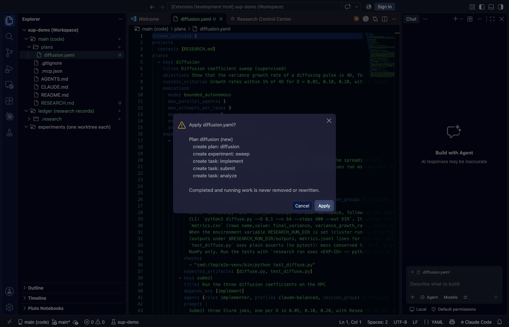
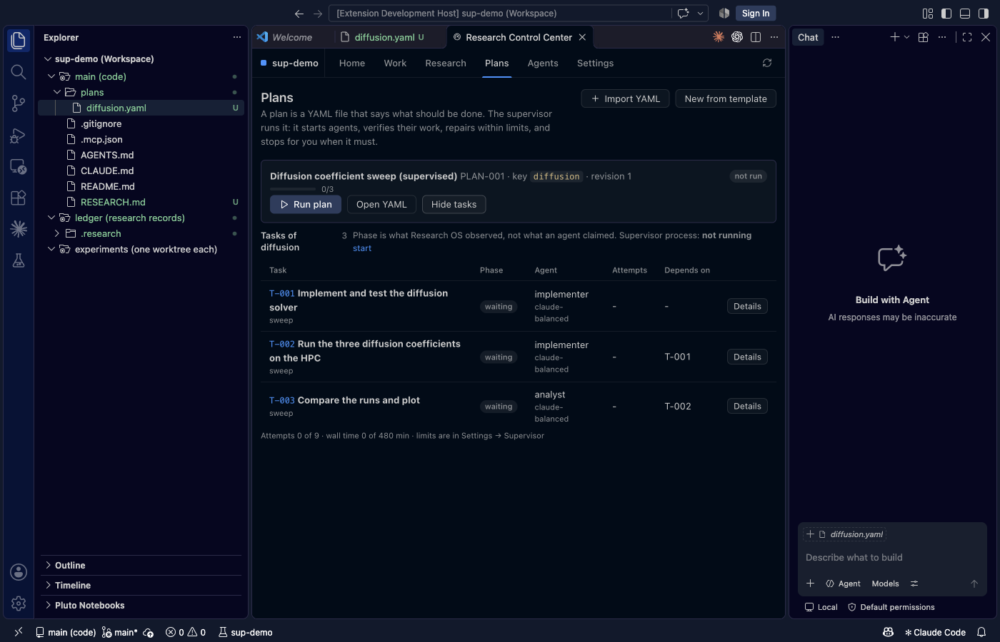

Pressing **Run plan** in the Plans tab started the supervisor process and the first agent:
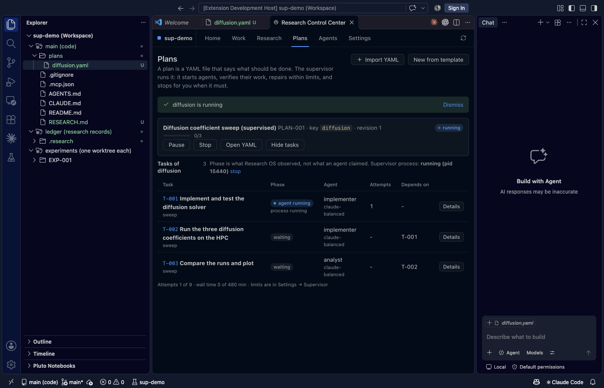

## 2. Results

Diffusion plan (final):

| Task | Attempts | Evidence |
|---|---|---|
| T-001 implement | 3 (2 voided, see §3) | `test_diffuse.py` passes under supervisor verification (3/3 checks) |
| T-002 HPC | 1 | Slurm jobs **203905, 203906, 203907** COMPLETED on node004 (`evidence/sacct.txt`); runs RUN-0004..6 linked to the attempt; metric check `variance_growth_rate>=0.1` passed on the *collected* metrics |
| T-003 analyse | 1 | `outputs/figure/diffusion_comparison.png` produced via `research run exec`; file check passed |

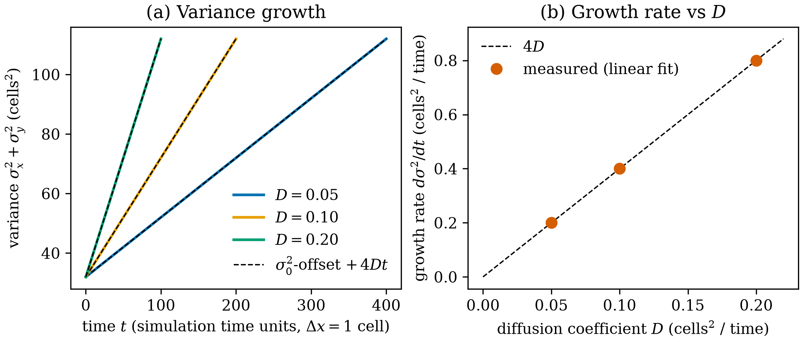
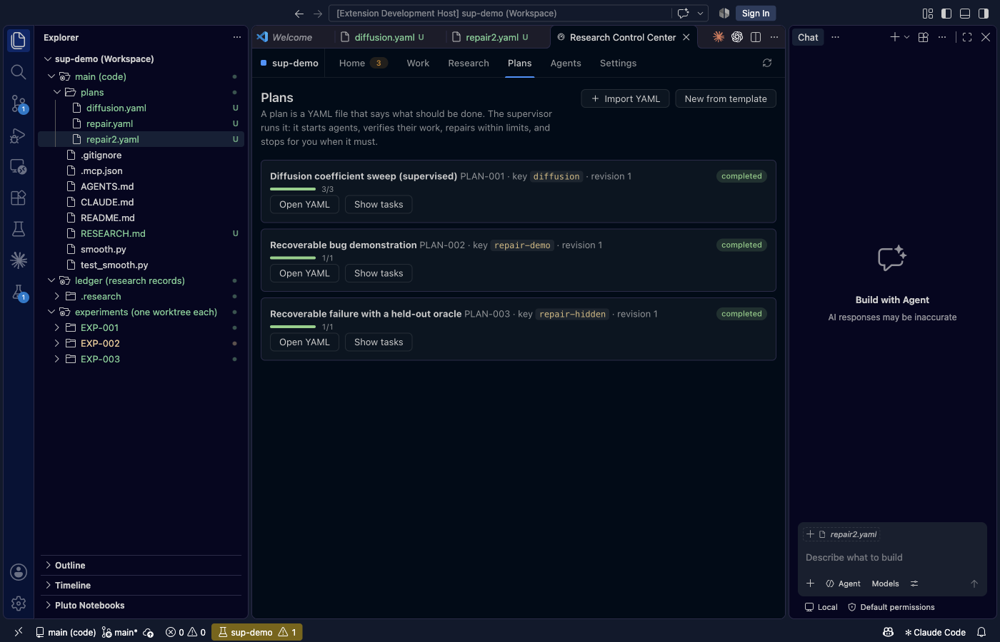

Measured growth rates agree with 4D (the T-001 test asserts within 1%; the figure shows the dashed 4D line on the data).
Cost of every agent session in the project including failed ones: **about US$2.4** (list price as reported by the CLI). Wall time of
the diffusion plan, excluding my debugging pauses: roughly 5 minutes of agent time.

Repair (`repair-hidden`): attempt 1 failed the held-out check, and the UI shows exactly what the next agent receives:
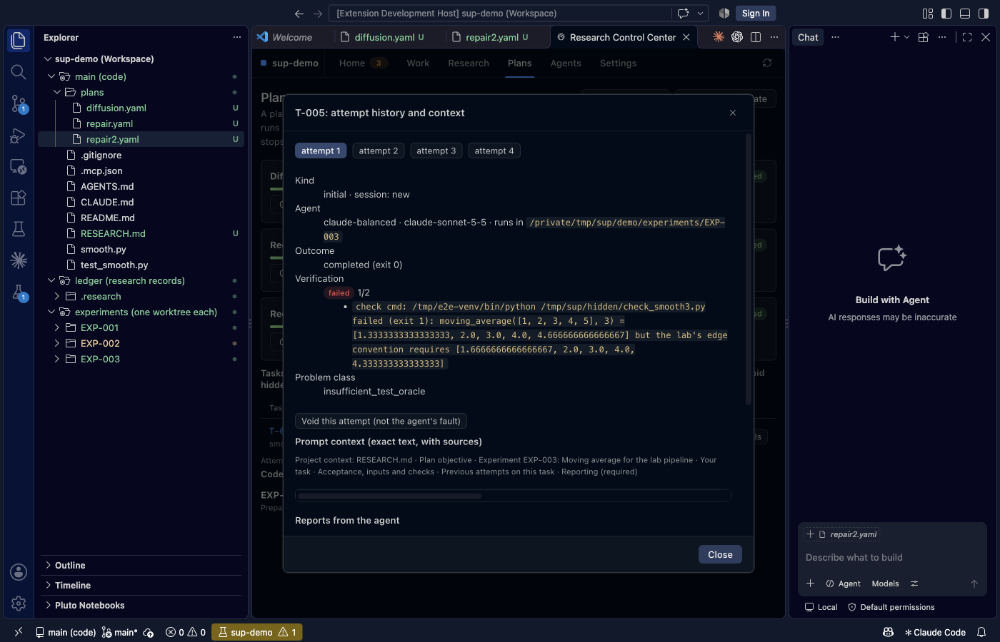

The repair attempts then used **native session resume** (`claude -p --resume <id>`; the session id was read from the agent's JSON output,
and the installed CLI's `--help` was probed first). **Honest caveat:** attempts 2 and 3 were killed by a *provider usage-limit error (429)*
at the end of their work; the agent had already written the corrected `smooth3.py` (reflection padding) before that. I voided those two
attempts from the UI (they stay in the ledger) and attempt 4 resumed the same session; the agent reported the file was already correct
and the supervisor's verification passed. So the failure detection, diagnostics hand-off, native resume and re-verification are real; the
code fix itself happened inside a voided attempt.
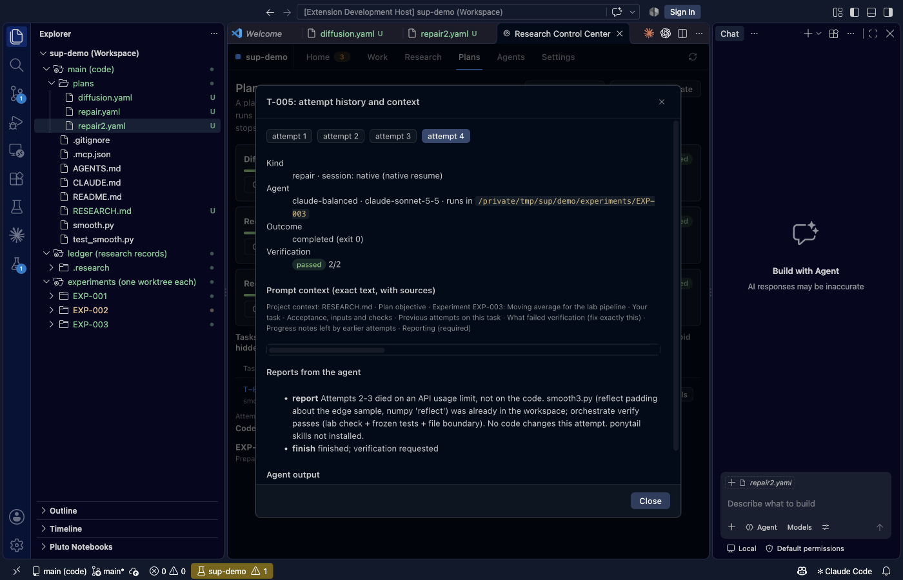

Plan-change proposal approved in the UI (applies through the same engine, revision 1 → 2). The patch was **injected by me** to
exercise the flow; no agent proposed it:
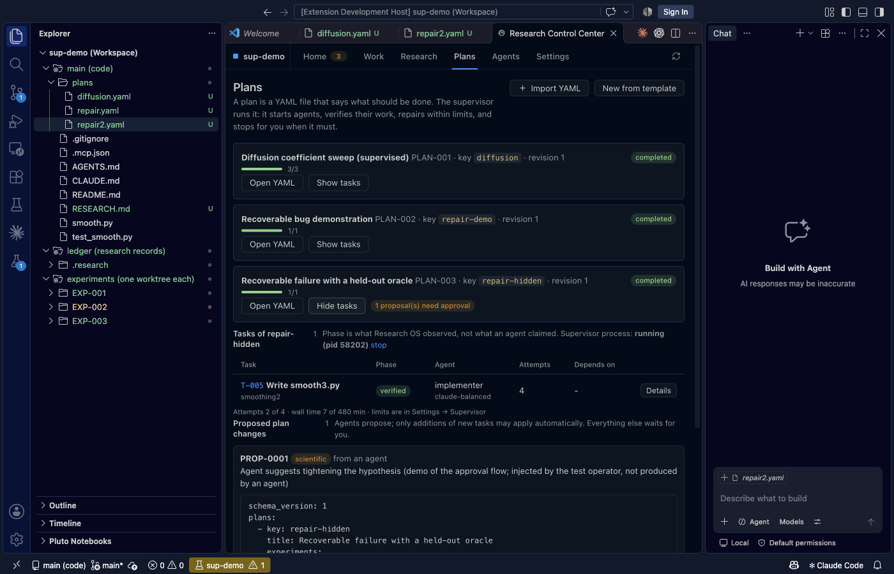
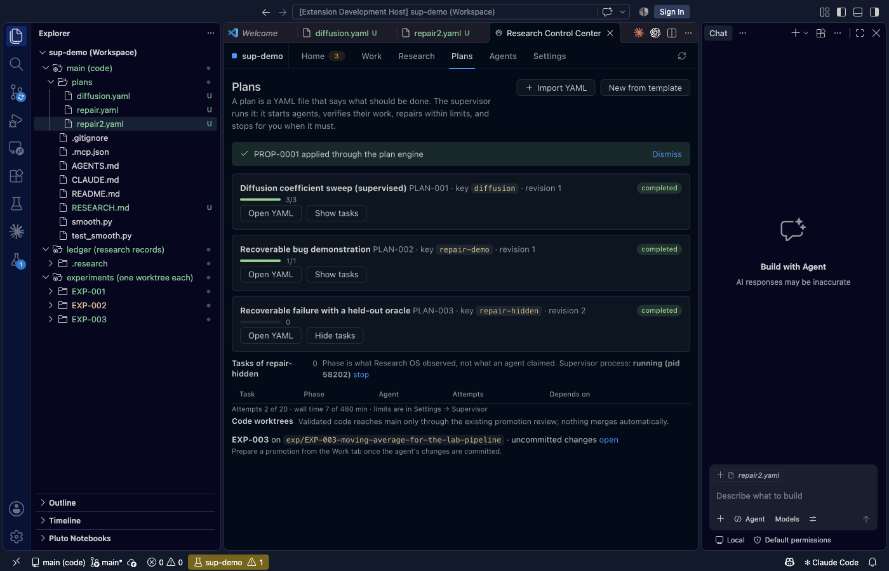

Settings (typed registry, help text, origin, defaults):
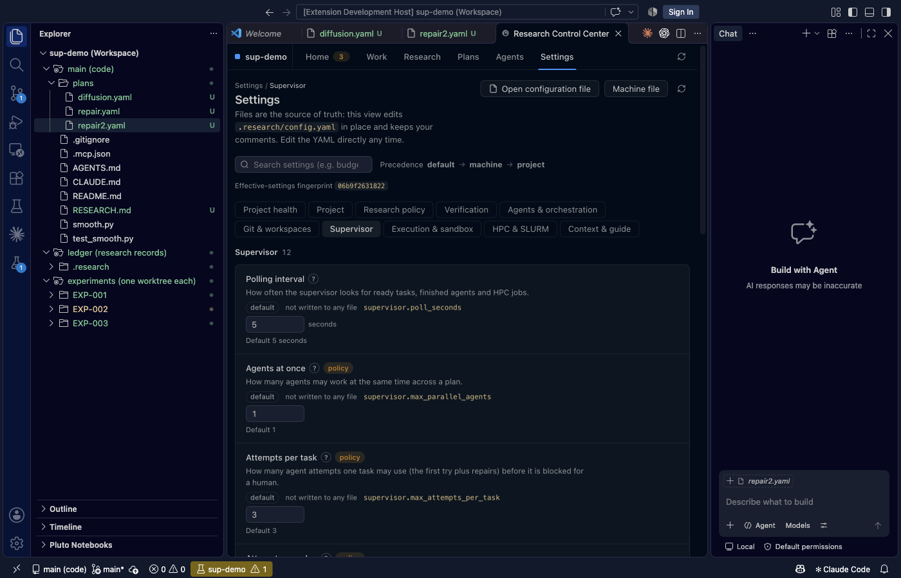

## 3. Defects found by the real runs (all fixed, each with a regression test)

1. **Supervisor held the task claim, so every agent's mandatory `research task start` failed** and the agent correctly stopped.
   Attempts 1–2 were wasted. Fix: the supervisor's ledger is the reservation; the task claim stays free. (Mock tests could not show this.)
   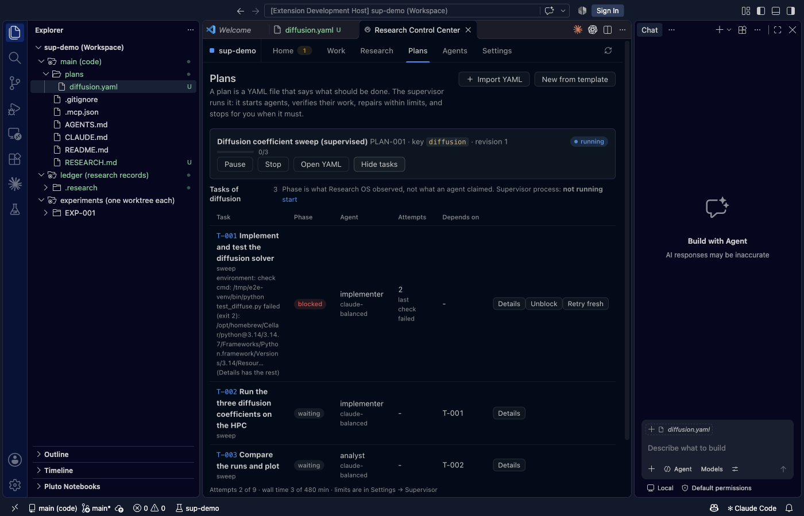
2. **Frozen tests frozen inside a worktree looked "modified" from the project root**, blocking verification of good work. Fix:
   frozen paths resolve in the task's workspace.
3. **The daemon, started as `python -m research.supervisor`, held a second copy of the module**, so the supervisor's completion grant was
   invisible to the guard and every tick raised. Fix: `research.supervisord` entry module + a detached-daemon regression test.
   The T-002 attempt of the diffusion plan was launched by one **manual `tick` from a debug script** while the daemon was failing;
   T-003 and everything afterwards ran from the repaired daemon.
4. **A provider usage limit consumed repair attempts.** Now: the attempt is kept as evidence, not counted, the task goes to *attention*
   and nothing is retried blindly.

Also fixed along the way: UI table overflow from very long reasons; missing **Re-verify** and **Void this attempt** actions.

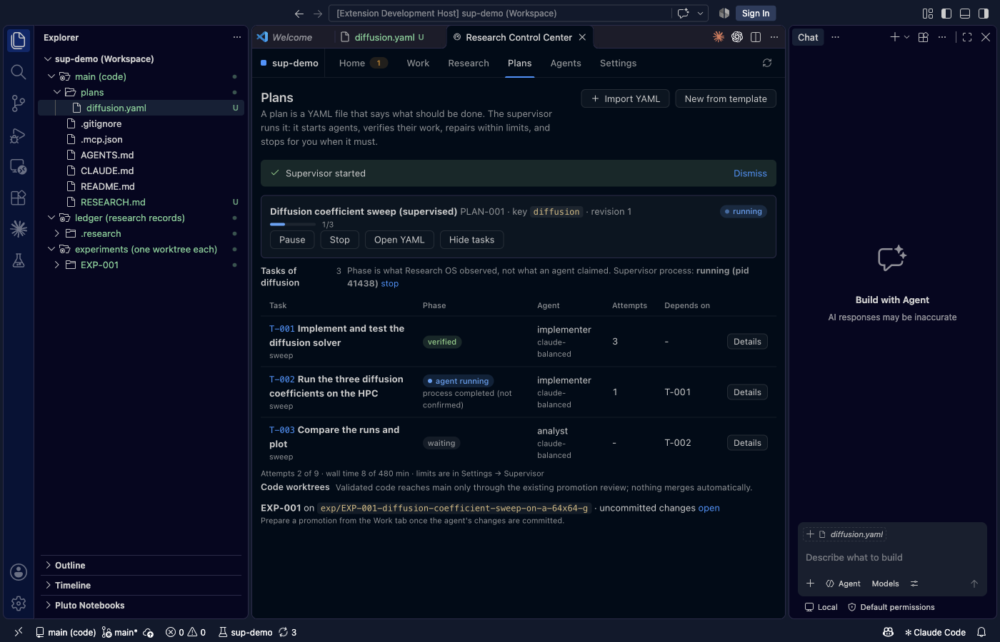

## 4. Status matrix

| Area | Status | Evidence / note |
|---|---|---|
| YAML schema, validate/diff/apply/export, idempotence, round trip | PASS | unit tests; applied via UI |
| Retire unstarted, protect done/running, stale revision, partial scope | PASS | unit tests; not exercised in the real runs |
| Interrupted apply recovers | PASS (observed) | a CLI apply stopped by a policy gate resumed in the UI without duplicates |
| Dependency ordering, parallel cap, one active attempt per task/workspace | PASS | tests + real run (sequential) |
| Parallel agents > 1 | PASS | real: three agents (Codex + two Claude, three experiments) ran at once (§4a); mock tests: cap 2 overlaps, cap 1 serialises, one worktree never shared |
| Verification only by supervisor; bypass via CLI/update/file edit | PASS | tests (CLI update, `complete_task`, hand-edited mirror) |
| Same bypass via MCP/RPC | PARTIAL | same core function; not separately attacked |
| Agent reports validated against active execution | PASS | tests; used by real agents (progress/artifact/report/finish/problem) |
| Daemon survives UI close, restart reconciles | PASS | daemon outlived VS Code restarts during the run |
| Unknown execution state never retried | PASS | test only |
| Claude dispatch in the experiment worktree | PASS | real run; cwd check |
| Codex dispatch / native resume | PASS | real (§4a): thread id parsed from `codex exec --json`, repair ran `codex exec resume` on the same thread and verified |
| Native Claude session resume | PASS | real (see §2) |
| Context hand-off | PARTIAL | used (attempt 3 `session: handoff`); not compared against resume |
| Bounded repair with diagnostics | PASS (real) | caveat in §2 |
| Provider-limit handling | PASS | found live, fixed, unit-tested; recovery after reset verified live |
| Scientific change needs approval; operational auto-applies | PASS | unit tests; approval live (injected patch) |
| Agent-proposed change end to end | PASS | real (§4a): a Claude agent proposed a follow-up task, it auto-applied as operational and ran |
| Real Slurm submit by agent, wait, collect, verify | PASS | jobs 203905–7 |
| Failed / waiting HPC job through the supervisor | PASS | real Slurm (§4a) and mock tests; unknown job status still only reasoned |
| Duplicate-submission protection | PARTIAL | by design (supervisor never submits; waits for non-terminal runs); no adversarial test |
| Promotion of supervised work into `main` | PASS | real (§4a): verified work committed on its branch, candidate prepared by the supervisor, tests/review/approval/merge in the UI, `main` has the file with provenance |
| VS Code: import/preview/apply, run/pause/resume/stop, status refresh, details, approvals, settings | PASS (live) | screenshots; pause/resume/stop only unit/RPC-tested |
| Security: sandbox enforcement | NOT IMPLEMENTED | restrictions are advisory unless a sandbox profile is used (SUPERVISOR.md §11) |

## 4a. Follow-up real runs (closing the gaps)

Plan `real-more` (one YAML, imported and run from the UI; `examples/supervisor-e2e/plans/more.yaml`, timeline in `evidence/status-timeline-more.txt`):

| Gap | What happened (all real: Claude + Codex CLIs, real Slurm) |
|---|---|
| **More than one agent at once** | `max_parallel_agents: 3`. Codex (T-006), Claude (T-007) and Claude (T-008) were all `running` together at 19:26:27, in three experiment worktrees; T-009 (HPC) started as slots freed. |
| **Failed HPC job through the supervisor** | T-009 attempt 1 submitted a deliberately failing job (RUN-0011, exit 3). Verification failed: "computational run(s) did not complete: RUN-0011 [failed]". Attempt 2 (native Claude resume) submitted RUN-0012 (completed) and verified; both runs are linked, the failed one is kept. |
| **Agent-originated proposal** | T-008's agent wrote a patch and ran `research agent propose`; PROP-0002 (`source: agent …`, operational) applied through the plan engine, creating T-010 which ran and verified. |
| **Codex session ids / resume** | Observed first-hand: `codex exec --json` emits `{"type":"thread.started","thread_id":…}`; `codex exec resume --json <id> "<prompt>"` continued the conversation. Plan `codex-resume`: Codex attempt 1 printed `Lab status: ready`, the held-out check wanted another banner; attempt 2 ran `codex exec resume` on the same thread (`01a19ed0…`) with the diagnostics and verified. (In `real-more` the Codex agent guessed its held-out greeting on the first try, so that run shows dispatch and parallelism, not resume.) |
| **Promotion of supervised work** | Verified tasks were committed on their experiment branches (`Research-Task:` trailers; `outputs/` excluded). *Prepare promotion from verified work* created candidates; for PROMO-006 I ran the tests, approved the review and the promotion, and merged from the UI. `main` now has `a.txt` in commit `T-007 Write a.txt … (cherry picked from commit 47d0b5a…)`. |

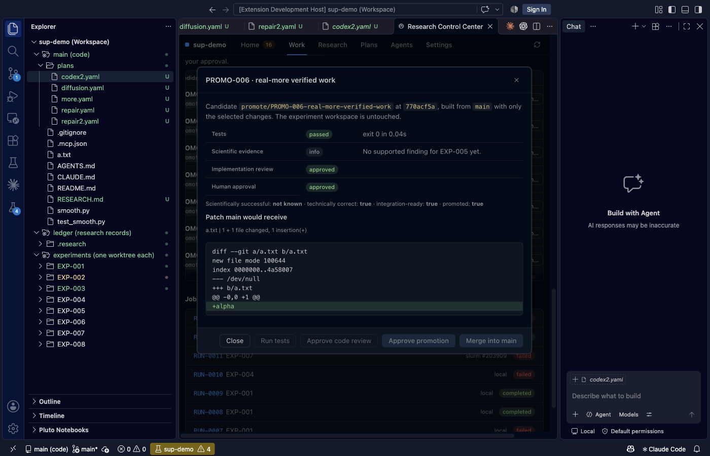
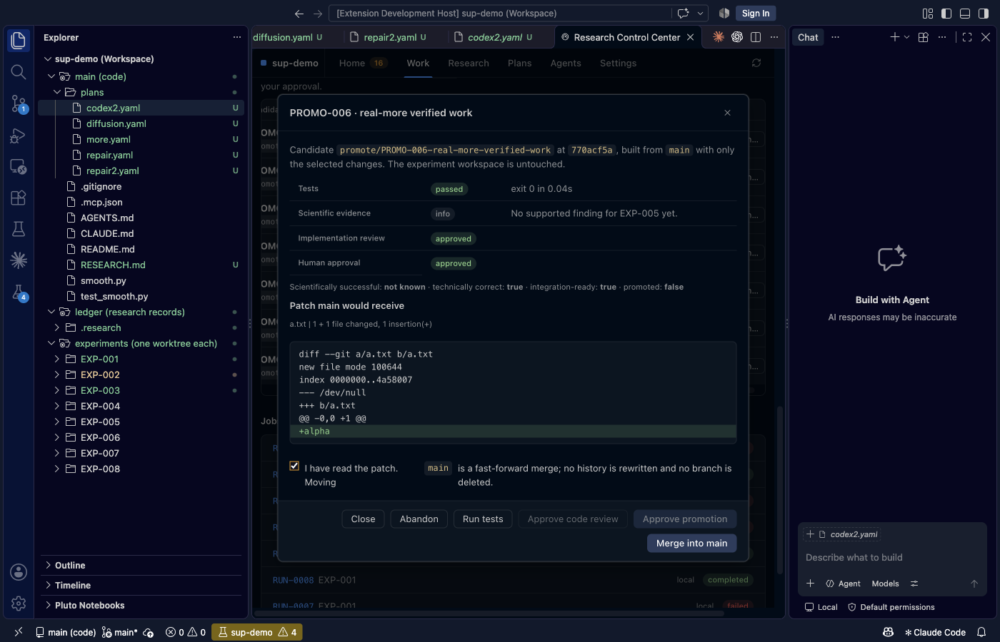

Defects found by this round (fixed, with tests): partial YAML patches (agent proposals) replaced the stored plan spec and dropped the existing
tasks from the supervisor's view; a repair attempt could be blamed for the previous attempt's failed run (second-resolution timestamps; runs
are now attributed by id snapshot at launch); completed computational runs alone were rejected as "no verifier"; the promotion
candidate was prepared under the researcher's identity, so the "preparer cannot review" rule blocked them (the supervisor now prepares);
an agent's proposal wrote a `RESEARCH.md` template into its worktree and committed it; and the promotion dialog did not enable
*Approve code review* after tests passed until reopened. The `repair-hidden` plan in the demo project still shows no tasks because it
was patched before the merge fix; new projects are not affected.

Caveats: Codex's sandbox has no network, so a Codex task cannot submit Slurm jobs itself; commit trailers and `patch.yaml` scratch files
the agents left in their worktrees were committed (`patch.yaml` appears in PROMO-007); I edited the demo project's config to
`promotion.require_supported_finding: false` because those toy experiments have no findings.

## 4b. Short stress tests

Not hour-long; each is minutes. Mock-agent tests run in CI (`tests/python/test_supervisor.py`), the real ones used Claude and Slurm.

| Test | Result |
|---|---|
| Three plans, nine tasks, running at once in three worktrees (mock) | all complete; peak ≥ 2 agents; every task launched exactly once; one worktree per plan |
| **Daemon `SIGKILL` mid-run**, restart (mock, detached daemon process) | the running agent survived, the restarted daemon finished the plan; no task launched twice |
| **Same with real Claude agents** (`evidence/stress-real.txt`): two plans, `claude-fast`, daemon SIGKILLed with two agents running, restarted | both plans completed, 4/4 tasks verified, **1 attempt each** |
| HPC status unreadable (every `hpc sync` raises) for many polls | task stays `waiting_hpc`; no new attempt; no second Slurm run |
| Supervisor "dies" between preparing and starting an agent | the unstarted launch is re-fired once; one execution record, run once |
| 12 independent tasks over 4 experiments, 4 agents at once (mock) | 12/12 verified, 12 attempts |
| `research hpc doctor --compute` on the real cluster (`evidence/hpc-doctor-compute.txt`) | proves `numpy` imports on a compute node, the failure that cost three Slurm jobs earlier |

Found and fixed here: `daemon_status` treated a killed-but-unreaped supervisor as running (zombie); and a parallel cap applies **per plan**,
not across plans (documented; a global cap is a setting for later).

## 5. UX assessment (first-time researcher)  **6 / 10**

Good: one place (Plans) shows what is waiting, running, verifying, blocked; every attempt's exact prompt, verification diagnostics and
agent reports are one click away; actions (Re-verify, Retry fresh, Void) match real situations; YAML preview before apply is clear.

Friction:
* The plan author must know the environment: my checks used an absolute venv Python path (no project interpreter setting).
* The task table shows "agent running — process completed (not confirmed)" for a moment after exit; confusing.
* The *Attempts* column counts voided attempts while the budget does not.
* Only one plan's task list is open at a time, and the supervisor process has a tiny *start/stop* text link.
* Native file dialogs and VS Code's own sign-in/theme dialogs interrupt scripted use (a harness limit, not a product defect).
* Failure reasons are long strings; the table now truncates and Details has the rest.
* An agent that cannot run Python (headless allowlist) writes untested code unless the plan tells it to use `research run exec`.
* Humans are identified by self-declaration, so "human-only" is not authentication.

## 6. Verdict (updated after §4a)

**Experimental use only, but the gaps listed earlier are closed.** The supervisor core, YAML round trip, verification gates, repair with
native session resume (Claude **and** Codex), parallel agents across experiments, a failed and a succeeding Slurm job, an agent-originated
plan change, and promotion of verified work into `main` have each been exercised against real systems. Every one of those rounds also found
real defects (§3, §4a), which is the reason for the cautious verdict: roughly a dozen supervised tasks in total, one cluster, two providers,
toy-sized work, no long-running or interrupted-and-recovered plan under real load, and security that is advisory without a sandbox.
Implementation is broad and tested (24 supervisor tests, webview tests); integration confidence is limited to §2, §4 and §4a.
